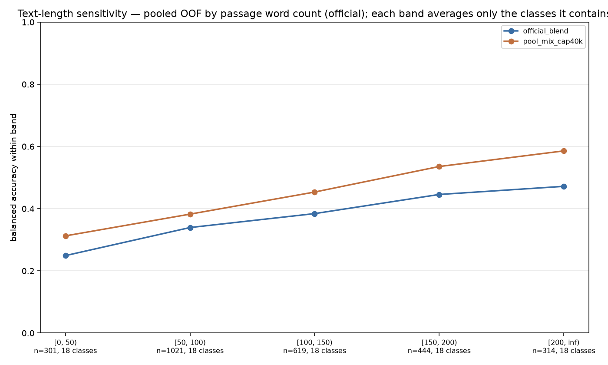
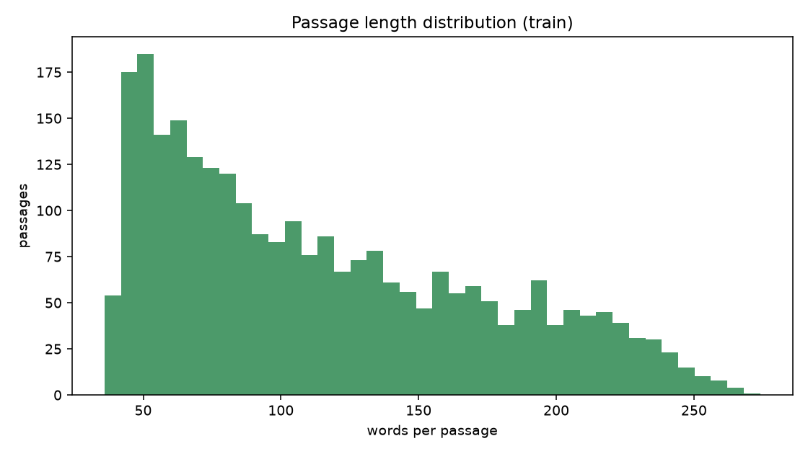
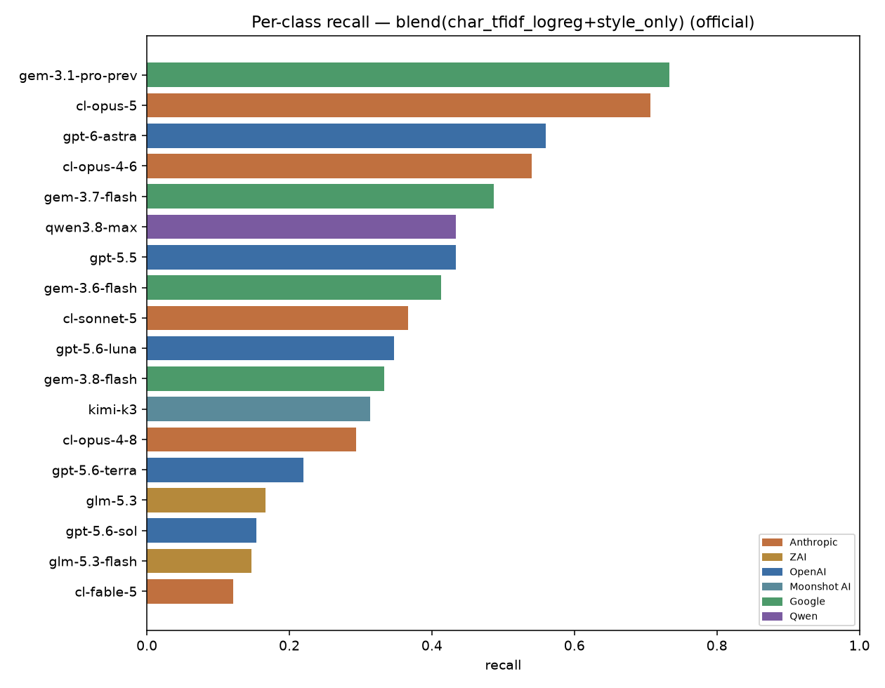
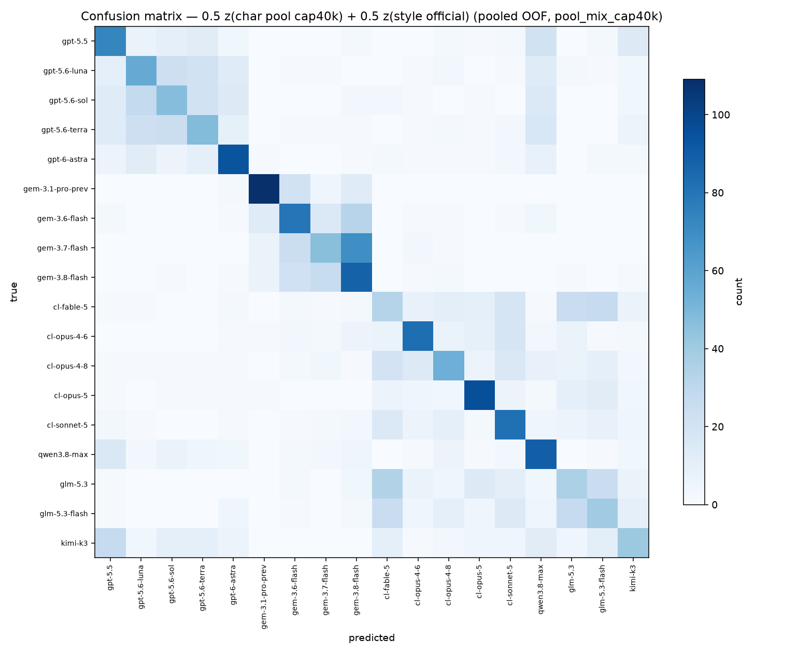
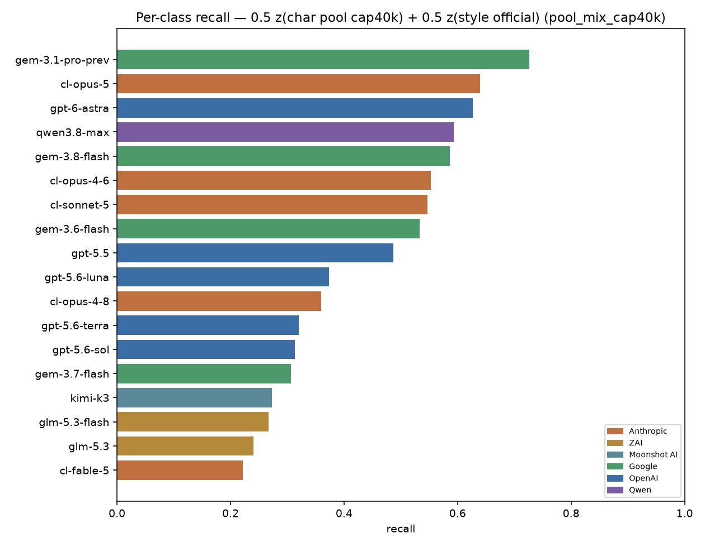
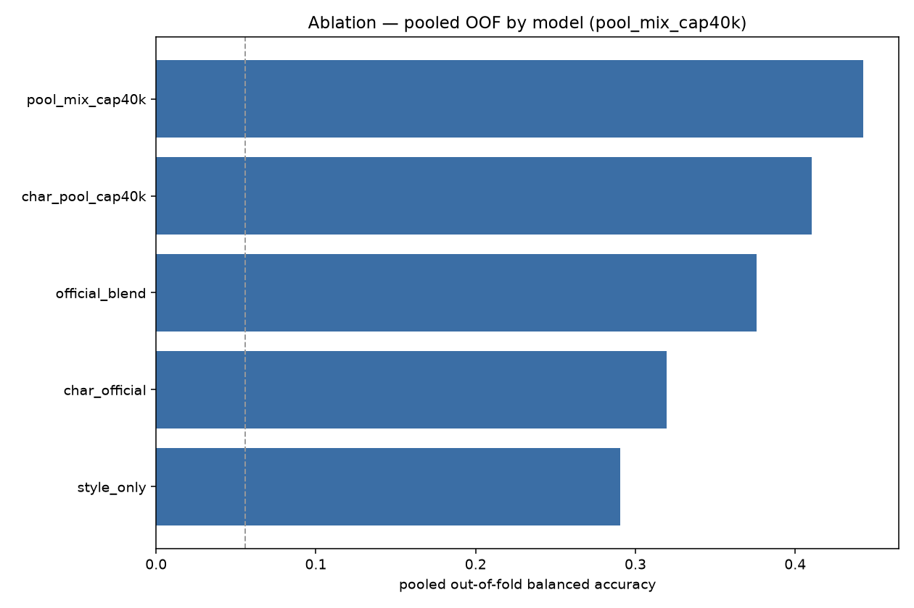
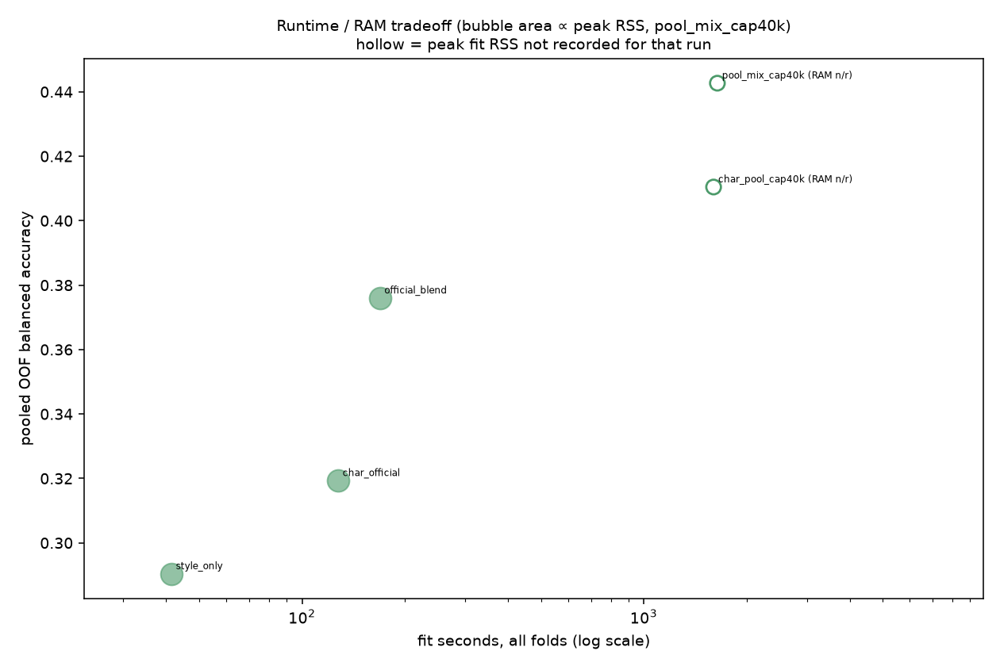
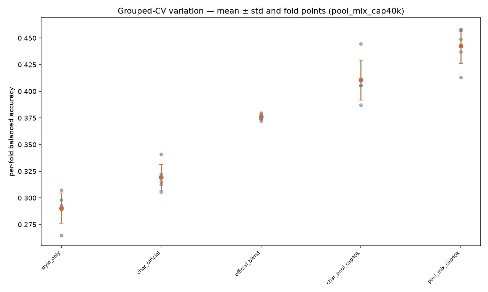

# Prompt-robust stylometric attribution of frontier language models

**Technical report — draft, revised 2026-11-17. Not a peer-reviewed publication.**

**Status:** methods implemented, tested and evaluated on the official training data
with prompt-grouped CV. **One leaderboard submission has been made**: submission
58344764 (notebook version 2, 2026-11-14) scored **0.356 public balanced accuracy**.
The private score and final rank are not yet published, so no rank or medal is claimed.
The synthetic-fixture numbers are kept only as a pipeline-validation baseline.

> **Revision history / superseded claims.** Read this banner before any section below.
> - **D017/D018 (2026-11-14):** the D016 crossed-design candidate, described as
>   "adopted" in §6.6, was **retracted**. Its gain was measured at the train design's
>   k=18 passages/prompt; under a hypothetical k≈2 the Hungarian paired gain collapses
>   to +0.003…+0.007 with a 95% CI spanning 0 on the examined holdout. Crossed inference
>   and damped Sinkhorn are **research-only** and are transductive, which the repository
>   reporting rule forbids in reported scores. The seed-7 holdout is **examined**, not
>   untouched.
> - **D024/D026/D027 (2026-11-16):** the 0.4442 DeBERTa+sparse blend is **superseded**.
>   Its pool arm used a *per-fold* decontamination screen, which is transductive (held-out
>   text selected training rows), and an identity-verified official-only rerun showed the
>   encoder adds no diversity gain (0.1915 alone; every sparse+DeBERTa blend ≤ sparse).
> - **D028/D035/D037/D039 (2026-11-16):** the pool was reopened under a **global,
>   fold-independent** screen. The current candidate is the **cap-40k pool-MIX blend** at
>   **0.4427 (s42) / 0.4304 (s13) / 0.4426 (nested outer gate)** grouped OOF, independently
>   reproduced from identity-verified OOF. The reserved seed-2027 holdout turned out to be
>   **examined**, so a nested outer-fold protocol replaces it as the final gate. These are
>   **CV numbers, not leaderboard scores**; the candidate is packaged but not submitted.
> - **D040 (2026-11-16):** packaged artifacts no longer carry a CV score measured for a
>   different fit.
> - **D041 (2026-11-17):** §8 now carries the measured **text-length sensitivity** of both
>   blends. Accuracy rises monotonically with passage length, and the external-pool gain is
>   largest on the longest passages (+0.1140 at ≥200 words vs +0.0431 at 50–100).
> - **D042 (2026-11-17):** §5.1 now carries the measured **blend-rule comparison** required by
>   plan §7. Row-z averaging is confirmed (best on the candidate); raw-margin, rank and softmax
>   averaging all lose, and min-max is indistinguishable rather than better. No weight, config
>   or packaged artifact changed.
> - **D043 (2026-11-17):** §9's inference runtime is now **measured, not estimated**: a cold
>   process running the notebook's exact path on 4,000 synthetic rows takes **13.77 s** with a
>   **0.370 GB** peak working set (8,000 rows: 28.24 s / 0.542 GB). Local CPU, not a Kaggle-runtime
>   benchmark; no competition row scored.
> - **D044 (2026-11-17):** §7.1 reports the **class-intercept tuning** required by plan §7 and
>   **rejects it**: nested-tuned biases lose −0.0097 on seed 42 and gain only +0.0052 on seed 13,
>   both CIs spanning 0, with inner-vs-outer optimism gaps of +0.0218 / +0.0065. The blend keeps
>   zero intercepts.
> - **D045 (2026-11-17):** the missing **style-only LinearSVC** arm is measured (0.2844) and loses
>   to logistic regression (0.2904); paired −0.0060, CI [−0.0145, +0.0026]. All three classifier
>   families named in plan §4 are now covered. Logreg stays.
> - **D046 (2026-11-17):** §8.3 adds the **per-feature style analysis** required by plan §4, with a
>   drift-0.0 proof that the refit reproduces the recorded OOF. `rate_dash` dominates and splits
>   claude/glm from gemini-flash. Explicitly **associational, not causal**; no feature changed.
> - **D047 (2026-11-17):** §4 records a **near-duplicate audit of the official corpus**: over
>   3,640,951 unordered pairs, every pair above cosine 0.3 is same-prompt and **zero cross a fold
>   boundary** at any threshold up to 0.9. Group separation is measured, not assumed.
> - **D048 (2026-11-17):** §8.4 measures **per-prompt-group error concentration** (plan §3 L118).
>   The worst decile of prompts carries no more error than a binomial null predicts, no prompt
>   collapses to one answer, and the pool gain is broad: **96 of 150 prompts improve**, paired
>   +0.0666 [+0.0497, +0.0836]. Errors are a per-passage problem, not a hard-question problem.
> - **D049 (2026-11-17):** §7 adds the fourth style-only classifier family, **CatBoost**
>   (0.2830 vs logreg 0.2904; paired −0.0074, CI [−0.0212, +0.0064]). It is not complementary
>   either: its row-z scores correlate 0.8678 with the logreg style member, and both the swap
>   (0.3652) and the equal-thirds blend (0.3686) lose to the adopted 0.3760. Optional dependency;
>   no member, weight or package change.
> - **D050 (2026-11-17):** §11 records a **compliance and freshness fix to the upload-ready
>   package**, not a modelling result. `cli package` had declared **CC0-1.0** while shipping a
>   bundle derived from CC BY-SA 4.0 text (official train + Open Pool v15); it now declares
>   **CC-BY-SA-4.0** with a README attribution block. Re-packaging also refreshed four stale
>   `src/` files. Both bundles are **byte-identical** (no refit) and `weights.json` keeps the
>   D040 provenance fix. Re-validated from the package's own shipped `src`: 4,000 synthetic rows
>   in **9.40 s / 0.370 GB** peak working set. No score, candidate or blend rule changed.
> - **D051 (2026-11-18):** the candidate's **ablation, runtime/RAM and grouped-CV variation**
>   panels now exist (§12), closing the last figure gap. `experiments/candidate_figures.py`
>   rebuilds five arms from the identity-verified OOF and reproduces every recorded pooled
>   **and** per-fold score within 1e-6 — a fourth independent reproduction of 0.3760 / 0.4427.
>   New finding: the candidate's fold spread is **6.31x wider** than the fallback's
>   (std 0.0166 vs 0.0026), though the gain stays positive in all five folds. Peak fit RAM was
>   never recorded for the pool arm and is shown as **not recorded**, never estimated.
>   No score, weight or package change.
> - **D052 (2026-11-18):** the competition Discussion was swept (spec §11). The hidden-test
>   prompt count stays **unknown** — the host thread has zero replies. Two participants report
>   ModernBERT-large ≈0.55 against their own DeBERTa-v3-large 0.50, so D027's encoder negative
>   is **backbone-specific** (queued as H8). No registry row: a sweep is not an experiment.
> - **D053 (2026-11-18):** **H9 hard typographic family vetoes measured and not adopted.**
>   Per-fold-mined punctuation-absence rules move the candidate 0.442675 → 0.443415
>   (+0.000741) with paired 95% CI **[−0.001316, +0.002797]**, which includes 0. Nine flips
>   in 2,699 rows, none from a correct prediction. Two corrections came out of it: the chance
>   level must count **distinct prompts, not rows**, and an oracle headroom claim needs a
>   no-veto control on the same rows — with it, the veto's own share is **−0.000370**.
>   No score, weight or package change.
> - **D054 (2026-11-18):** **H8 was queued but unrunnable.** The GPU kernel is a Kaggle *script*
>   kernel, which receives **no CLI arguments**, so `--model-name` never reached a pushed run;
>   and `transformers>=4.45` predates ModernBERT (4.48). A module-level `BACKBONE` switch now
>   selects the preset, the choice is recorded in the run config and inference manifest, and the
>   budget (384/4/1e-5) is held fixed across presets so the probe changes one variable.
>   Enabling infrastructure only — **no metric**, GPU run owner-side.
> - **D055 (2026-11-18):** **Larger ensembles re-tested against the pool candidate — negative.**
>   D049's equal-thirds trial used the *official-only* char member; the candidate's char member is
>   pool-trained (0.4104), so the trade-off changed. Six identity-verified third members at
>   pre-specified equal thirds and 0.4/0.4/0.2 **all lose** against base 0.442675 (best
>   `word_tfidf_linearsvc` 0.435240, paired −0.007471 [−0.022787, +0.007845]; all six thirds CIs
>   exclude 0). The most diverse arm (embedding-only, row-z corr 0.343) is the weakest (0.1278):
>   diversity without strength does not pay. Two pre-D024 OOF sets were re-run for provenance
>   (`configs/blend_members.yaml`, `configs/frozen_encoder.yaml` offline). Descriptive screen —
>   no arm was promoted to a gate, and no weight, member or package changed.
> - **D056 (2026-11-18):** **H10 — the first positive third-member signal, still not adopted.**
>   Giving the word view the *same* non-transductive pool advantage lifts it 0.2697 → **0.3549**
>   (s42) and 0.2559 → **0.3463** (s13), both paired CIs excluding 0. The pre-specified
>   0.4/0.4/0.2 recipe then beats the two-member base on **both** seeds: **0.450082**
>   (+0.0074 [−0.0126, +0.0274]) vs 0.442675, and **0.440057** (+0.0096 [−0.0099, +0.0292])
>   vs 0.430435 — up on 4 of 5 folds each time, with a different losing fold. Both CIs include 0
>   and the arm was read off the reporting OOF, so it is **descriptive** (D026); a nested
>   outer-fold recipe gate (`experiments/nested_recipes.py`, outer 3/s121, inner 3/s71) is running.
>   Swapping style out for this member is negative on both seeds. Candidate, weights and package unchanged.
>
> Sections 6.1–6.7 describe the official-only baseline and the withdrawn research tracks
> and remain valid as historical evidence. **Section 6.8 is the current result.**

---

## Abstract

We study 18-class authorship attribution for short passages generated by
frontier language models, where the hidden test passages answer prompts absent
from training and the metric is balanced accuracy (mean per-class recall). The
system combines character/word TF-IDF with deterministic stylometric features and
balanced linear classifiers, evaluated with prompt-grouped cross-validation and
strict per-fold fit hygiene. We describe a deployable prompt-nuisance
suppression method that removes directions of between-prompt variation using
training prompts only, and distinguish it from the non-deployable
prompt-centring diagnostic. On a synthetic fixture built to mimic the schema and
style structure, the pipeline runs end-to-end on CPU in about two minutes and the
sparse baselines score 0.095–0.234 pooled out-of-fold balanced accuracy against
0.051–0.054 for reference baselines, while stylometric models reach 0.472–0.482
on the fixture. On the official training data (2,699 passages, 150 prompts, five
prompt-grouped folds) character TF-IDF reaches 0.3193 and stylometry alone
0.2904; blending the two gives **0.3760** pooled out-of-fold balanced accuracy
(+0.0567 over the best single model, positive in all five folds). Errors
concentrate within providers (53.3% of errors), with sibling flash models the
most confused pair. A D016 research track recovered a crossed-design signal through test-time prompt
grouping: cluster test passages by frozen-MiniLM topic embedding into prompt
groups, then enforce one-per-model Hungarian assignment. It scored 0.5000 on the
seed-7 holdout at **k=18** (+0.1044) and 0.4716/0.4657 on grouped CV seeds 7/13.
**This candidate was subsequently WITHDRAWN (D017/D018):** the hidden test is k≈2,
where the Hungarian paired gain collapses to a marginal +0.003…+0.007 (95% CI
spans 0 on the examined holdout). The **argmax char+style blend (0.3760 full
grouped OOF)** was submitted and scored **0.356 public balanced accuracy**; it
remains the confirmed fallback, and the crossed track is research-only.

We then asked whether the remaining gap is a data-coverage problem rather than a
post-processing one. A public community corpus (Open Pool v15, CC BY-SA 4.0,
226,191 passages, all 18 labels) was audited and screened **once** against the full
official training set — exact text match plus word-TF-IDF cosine > 0.3 — leaving
226,049 clean rows and a single **fold-independent** keep-mask. This avoids the
transductive per-fold screen that an earlier attempt used, under which held-out
passages selected which pool rows were trained on. Adding the capped pool to the
character model alone lifts it from 0.3193 to **0.4104** (cap 40,000/fold, seed 42);
stylometry does not benefit, so the blend keeps style official-only. The resulting
**pool-MIX** blend — the same fixed 0.5/0.5 row-wise-z rule — reaches **0.4427**
(seed 42), **0.4304** (seed 13) and **0.4426** under a nested outer-fold gate whose
weights are pre-specified and whose pool is screened against outer-train only.
Paired gains over the 12,000-row cap are +0.0437 [+0.0238,+0.0636], +0.0315
[+0.0089,+0.0540] and +0.0908 [+0.0460,+0.1355] respectively, positive in every
fold, and the headline is independently reproduced from stored identity-verified
out-of-fold matrices by a second code path. Two negative results bound the claim: a
class-balanced cap repairs the starved `gemini-3.7-flash` class but *regresses* the
blend at both budgets, and a fine-tuned DeBERTa-v3 encoder adds no diversity gain
once the pool is removed (0.1915 official-only). The pool-MIX candidate is packaged
for offline inference but **has not been submitted**, so no leaderboard number
exists for it; grouped CV is not a leaderboard claim.

## 1. Introduction

Frontier models increasingly generate text at web scale. Auditing synthetic data,
detecting benchmark contamination and tracing provenance all require answering a
harder question than "was this machine-written?": *which* model wrote it.
Providers release sibling models (`gpt-5.6-luna`, `-sol`, `-terra`) whose
differences are subtle by design, and post-training choices leave stylistic
traces rather than topical ones.

The competition fixes a concrete setting: 18 models from six labs, passages of
40–250 words, unseen prompts at test time, and balanced accuracy so that a
frequent model cannot dominate. This report documents the engineering and
evaluation protocol, then the evidence we have — and have not — collected.

## 2. Related work

The method sits at the intersection of authorship attribution, stylometry and
model fingerprinting. Classical authorship attribution uses function-word and
character n-gram profiles with linear classifiers (Mosteller & Wallace, 1964;
Stamatatos, 2009, *A survey of modern authorship attribution methods*, JASIST).
Character n-grams are robust to topic shift, which motivates hypothesis H1.
Distribution shift under grouped validation is studied as domain generalisation
(Blitzer et al., 2007, *Domain adaptation via transfer component analysis*;
Gulrajani & Lopez-Paz, 2021, *In search of lost domain generalization*, ICLR).
Machine-generated text detection is surveyed by Chakraborty et al., 2023,
*On the possibilities of AI-generated text detection* (preprint) — detection is
easier than attribution. Benchmark contamination motivates provenance work such
as GPTBench-style auditing; specific claims about individual papers are **not**
asserted here without a verified citation, and this draft deliberately cites only
works the authors can check.

## 3. Dataset and rules

Verified on 2026-11-14 from the official Kaggle pages (see
`docs/competition_spec.md`): `train.csv` has 2,699 passages across 150 prompts
with `id`, `prompt_id`, `text`, `model`; `test.csv` has `id`, `text` only, with
unseen prompts and ~4,000 rows in the graded rerun; submissions are
`submission.parquet` with `id, model`; internet is disabled; external data and
pretrained models are permitted if publicly accessible. Competition data is
CC BY-SA 4.0 and is not redistributed here.

The audit (`docs/data_audit.md`, dataset fingerprint `6368e9c31e8d060f`) found
149–150 passages per model, 17–18 models per prompt (a near-complete factorial
design), no duplicate ids or texts, mean 114.7 words (p05–p95: 44–224), 57.84% of
passages containing non-ASCII characters, and no markdown or emoji anywhere. The
downloaded `test.csv` has three example rows.

**External corpus (candidate only, §6.8).** Open Pool v15
(`crtproduction/name-that-llm-open-pool`, CC BY-SA 4.0) is a public community dataset of
**226,191** passages covering the same 18 labels. Its class distribution is far from
balanced — `gemini-3.7-flash` 3,541 rows against 18,357 for `gemini-3.6-flash` and 23,474
for `gemini-3.8-flash` — which drives the sibling-starvation effect analysed in §6.8.
1,533 rows have no mapped prompt identifier, and no `prompt_canon`↔`prompt_id` crosswalk
is verified, so decontamination is text-level. Provenance, licence and the full audit are
recorded in `docs/external_data_register.md` and `artifacts/pool_audit/audit.json`. The
submitted fallback uses none of this data.

## 4. Experimental protocol

- Primary split: `StratifiedGroupKFold(5, shuffle=True, random_state=42)` on
  `prompt_id`, with `GroupKFold` fallback; exact indices persisted with a dataset
  fingerprint. Zero prompt overlap is enforced at runtime.
- **Near-duplicate audit (D047).** Group separation is measured, not assumed. Over
  all 3,640,951 unordered official-train pairs (word TF-IDF 1–2 grams, the same
  settings and 0.3 threshold as the pool screen): 0 exact duplicate texts, 0
  prompts spanning more than one fold, 2,190 pairs above cos 0.3 and 34 above 0.5
  — **every one of them same-prompt, zero cross-fold at any threshold**; nothing
  above 0.7, and the corpus maximum is 0.6223. The similarity that exists is the
  shared question vocabulary of the 18 answers to one prompt, which the grouped
  split keeps on one side of every fold. `experiments/near_duplicates.py` fits no
  predictor and stores ids and cosines only, never passage text.
- Secondary prompt-held-out split for a final robustness check, not for
  selection; repeated-seed runs for stability.
- Every learned transform — TF-IDF vocabulary and IDF, style standardiser, SVD
  basis, nuisance projection, classifier — is fitted on the training side of a
  fold only.
- Primary metric: pooled out-of-fold balanced accuracy; stability: mean ± std of
  per-fold balanced accuracy. Macro F1, per-class recall, confusion matrices and
  within-provider confusions are diagnostics, not selection criteria.
- Classes absent from a validation fold are skipped, with the absence reported.
- **Uncertainty (D018).** Method comparisons are reported as *paired* per-fold or
  per-group differences with a 95% CI (`src.metrics.paired_difference` / `mean_ci`),
  never as a bare difference of two pooled scores, and never as a best-of-grid.
  k-subsampling (k = 1, 2, 3, 18) is an **inference-only stress test** for
  batch-dependent methods, not a selection score; the primary metric for
  per-passage models is the full grouped OOF.
- **OOF identity (D024).** Every out-of-fold matrix stores the ordered-dataset
  SHA-256 and the per-row validation fold ids. `load_oof` rejects legacy files
  without them and `verify_oof_alignment` rejects any member whose folds or
  fingerprint differ from the requested split, so a blend cannot silently combine
  predictions made on different row orders or different folds.
- **External-data eligibility (D026/D028).** A per-fold decontamination screen is
  transductive — held-out passages decide which pool rows enter training — and is
  disabled. The permitted route screens the pool **once** against the complete
  official training set and reuses one keep-mask in every fold. Pool caps are
  chosen from class counts and a fixed seed only, never from validation scores.
- **Final gate (D035).** The reserved seed-2027 holdout was found to be *examined*
  (it had participated in earlier full-OOF development), so it cannot serve as an
  untouched test. It is replaced by a nested prompt-grouped outer-fold evaluation:
  3 outer folds, the blend rule **pre-specified** (fixed 0.5/0.5 row-wise z), and
  the pool screened against each outer-train only. This removes CV-selection
  optimism from the candidate's headline number.

## 5. Methods

**Sparse text models.** Character (2–5), `char_wb` and word (1–2) TF-IDF with
capped vocabularies, sublinear TF, float32, paired with LinearSVC
(`class_weight='balanced'`) or logistic regression. Margins are used directly and
treated as ordinal scores, not probabilities.

**Stylometry.** 44 deterministic features covering length, punctuation, formatting
(markdown, bullets, code fences, digits), Unicode composition, lexical diversity,
contractions, function-word rates, hedging and transition phrases, sentence-start
capitalisation and terminal punctuation. The block is standardised with
`StandardScaler(with_mean=False)` fitted per training fold — without it the
length columns (0–250) dominate the rate columns (0–20) and logistic regression
fails to converge.

**Prompt-invariance.** Two distinct objects:
1. *Diagnostic* prompt centring, `z_i − mean(z | prompt_i)`. It needs prompt
   identity at prediction time, which the hidden test set does not provide, so its
   score is an upper bound, not a submission candidate.
2. *Deployable* nuisance suppression: compute per-prompt centroids of the
   standardised feature space on training prompts (groups with ≥4 rows), take the
   top-k right singular vectors of the centroid matrix, and project the features
   onto the orthogonal complement. The projection is fitted on training data and
   applied unchanged to test features, so it needs no test prompt labels. It is
   applied in a dense SVD space for tractability.

**External training data (candidate only).** The pool is not a feature source: it adds
*training rows* to one member. `decontaminate_global` screens it once against the full
official train (exact text + word-TF-IDF cosine > 0.3) and returns a single fold-independent
keep-mask; `cap_pool_stratified` then draws a class-proportional budget (or
`cap_pool_balanced` a uniform one) using class counts and a fixed seed only. The char
member's vocabulary, IDF and classifier are still fitted per fold on that fold's training
side plus the capped pool, so no validation row enters any fitted transform. The style
member is trained on official rows only. See §6.8 for why the per-fold variant is forbidden.

**Ensembling.** Row-wise z-normalised margins (ignoring the placeholder for
classes absent in a fold). Greedy selection with replacement on pooled OOF, capped at a
few members and adopted only when it beats the best single model by the configured
margin, is how the **fallback** weights were found (`0.5 char + 0.5 style`). The
**candidate** reuses that rule with the weights **fixed at 0.5/0.5** rather than
re-selected, so its reported gain carries no weight-selection optimism. The
row-wise z-normalisation is part of the recipe, not a cosmetic choice: members produce
margins on different scales, so averaging them raw is a different estimator — now
measured, and worse (§5.1). `cli ensemble` restricts itself to explicitly configured members and
writes `candidate_weights.json`, never overwriting the active weights, because a blind
greedy pass over all saved OOF re-selects a model rejected in D013.

### 5.1 Blend-rule comparison (D042)

Plan §7 asks for simple averaging, rank-based and normalized-margin blending to be
compared. `experiments/blend_rules.py` scores five scale-only rules on the **same saved
OOF rows** with the same 0.5/0.5 weights, for both member pairs. It fits nothing, reads no
pool row and scores no test row, and reuses the D041 identity guards (dataset fingerprint
plus each member's OOF fingerprint, labels and fold ids). Because every rule sees identical
rows, the paired per-fold difference removes shared fold noise.

| rule | official-only BA | Δ vs row-z (95% CI) | pool-MIX cap40k BA | Δ vs row-z (95% CI) |
| --- | --- | --- | --- | --- |
| raw margin mean | 0.3241 | −0.0518 [−0.0747, −0.0289] | 0.4208 | −0.0219 [−0.0269, −0.0169] |
| **row-z mean (adopted)** | **0.3760** | — | **0.4427** | — |
| average-rank mean | 0.3619 | −0.0140 [−0.0296, +0.0015] | 0.4060 | −0.0367 [−0.0603, −0.0130] |
| min-max mean | 0.3760 | −0.0000 [−0.0096, +0.0096] | 0.4408 | −0.0019 [−0.0055, +0.0018] |
| softmax mean | 0.3030 | −0.0730 [−0.0984, −0.0475] | 0.4012 | −0.0415 [−0.0553, −0.0277] |

- **The adopted rule is confirmed.** Row-z is best on the candidate and every alternative
  loses there, three with a paired CI excluding zero. Raw-margin averaging is dominated by
  whichever member has the larger margin scale — exactly the mismatch row-z removes.
- **Min-max is indistinguishable, not better.** On the fallback it differs by 2e-6 (the
  script's `best_rule` field picks it by rounding noise) with a CI spanning zero, and it is
  worse on the candidate. No adoption follows.
- **Softmax is a diagnostic only.** LinearSVC margins are not probabilities (AGENTS.md), so
  the softmax arm is reported as a monotone transform of the margins, never as a calibrated
  probability, and it is not used for calibration.
- Absent-class sentinel cells are masked to each rule's neutral value (0.5 for rank/min-max,
  1/k for softmax, the row mean for raw, 0 for row-z); both pairs contain zero such cells.
- Selecting a rule on this OOF is mildly optimistic. The pre-registered adoption bar is
  unchanged: beat row-z on the alternative seed (s13) **and** the nested outer gate
  (D035/D039). Nothing here clears it, so no config, weight, artifact or packaged dataset
  changed. Nine unit tests (`tests/test_blend_rules.py`) pin the transforms, including exact
  agreement of the row-z arm with `src.ensemble.normalize_scores`.

## 6. Results

### 6.1 Official training data (submitted baseline)

Five prompt-grouped folds (1,200–1,400 held-out passages and 30 held-out prompts
per fold, zero prompt overlap), pooled out-of-fold balanced accuracy:

| model | pooled OOF | fold mean ± std | macro F1 | fit s (5 folds) |
|---|---|---|---|---|
| char TF-IDF + LogisticRegression | 0.3193 | 0.3193 ± 0.0119 | 0.3089 | 80.6 |
| char TF-IDF + LinearSVC | 0.3167 | 0.3167 ± 0.0134 | 0.3049 | 75.2 |
| word + char TF-IDF + LinearSVC | 0.3156 | 0.3156 ± 0.0094 | 0.3025 | 73.5 |
| `char_wb` TF-IDF + LinearSVC | 0.2963 | 0.2963 ± 0.0101 | 0.2877 | 49.6 |
| style only + LogisticRegression | 0.2904 | 0.2904 ± 0.0142 | 0.2792 | 29.6 |
| word TF-IDF + LinearSVC | 0.2697 | 0.2697 ± 0.0115 | 0.2539 | 7.5 |
| char + style TF-IDF + LinearSVC (unstable) | 0.2245 | 0.2244 ± 0.0849 | 0.2254 | 1213.8 |
| majority class | 0.0556 | 0.0556 ± 0.0000 | 0.1053 | 0.0 |
| stratified random | 0.0545 | 0.0545 ± 0.0047 | 0.0534 | 0.0 |

**Current best: a two-model blend.** Greedy OOF selection chose 0.5 × char
TF-IDF logistic regression + 0.5 × style-only logistic regression, scoring
**0.3760** pooled OOF versus 0.3193 for the best single model (+0.0567). The
gain is present in every fold: +0.0630, +0.0352, +0.0741, +0.0519, +0.0593. The
members are genuinely complementary — sparse character n-grams and 44 explicit
style statistics — which is exactly the diversity the blend needs.

The `char + style` LinearSVC row is reported but **not interpreted as evidence
about the representation**: two folds collapsed (0.0944, 0.1648) and liblinear
reported convergence failures, so its mean reflects an optimisation failure. The
logistic-regression version of char+style was stopped before completion (no
convergence after 2,000 iterations, >37 minutes, ~700 MB RSS) and is excluded
from `configs/features.yaml`; on the fixture it was the best model, which is why
the concat idea is not abandoned, only unproven here.

### 6.2 Pipeline validation on the synthetic fixture (superseded)

The fixture (`src/synthetic.py`) generates 18 models with probabilistic style
profiles (sentence length, punctuation, markdown, hedging) over shared topical
text, 40–250 words, 150 training prompts and 60 disjoint test prompts. It exists
because the repository must be testable without the competition data.

5 prompt-grouped folds, 1,671 training rows, pooled out-of-fold balanced accuracy:

| model | pooled OOF | fold mean ± std | macro F1 | fit s (5 folds) |
|---|---|---|---|---|
| `char_wb` TF-IDF + LinearSVC | 0.2341 | 0.2342 ± 0.0147 | 0.2233 | 22.5 |
| char TF-IDF + LogisticRegression | 0.2091 | 0.2096 ± 0.0090 | 0.2040 | 29.9 |
| char TF-IDF + LinearSVC | 0.2061 | 0.2059 ± 0.0111 | 0.1996 | 43.9 |
| word TF-IDF + LinearSVC | 0.0951 | 0.0945 ± 0.0144 | 0.0946 | 3.2 |
| majority class | 0.0535 | 0.0556 ± 0.0000 | 0.0934 | 0.0 |
| stratified random | 0.0510 | 0.0514 ± 0.0061 | 0.0504 | 0.0 |

Greedy blending selected the single best model (gain 0.0000), so no blend was
adopted — the selector declines to add complexity without validated gain.

Adding stylometry dominates on this fixture (section 7): style-only reaches
0.4723 and char+style logistic regression 0.4823, versus 0.2061 for char TF-IDF
alone. On a smaller 40-prompt fixture (428 rows, 3 folds), a 3k-feature char
model scored 0.1477 while the style-only model scored 0.3697 pooled OOF. The
fixture encodes style at the punctuation/formatting level, and grouped folds
correctly refuse to reward char n-grams that memorise shared prompt content. This
is the clearest evidence in the fixture run that the grouped protocol is doing
its job, and it motivates H1/H2 rather than settling them.

### 6.3 Hypothesis status

| hypothesis | status |
|---|---|
| H1: character/typography features generalise better across prompts than semantic word features | **partially supported on official data**: char 0.3167 vs word 0.2697 (+0.047), and `char_wb` 0.2963 also beats word. Style alone (0.2904) is close to char. |
| H2: prompt-invariance techniques improve grouped validation | **not supported as configured**: deployable nuisance suppression (k=8) lowers pooled OOF for char (0.3034→0.2434) and style (0.2904→0.2737); SVD-256 compression alone also slightly lowers char (0.3167→0.3034). See §6.4. |
| H3: frozen encoders complement sparse stylometry | **measured, not supported for adoption**: a frozen MiniLM encoder scores 0.1278 alone and 0.3093 with style; the greedy char+encoder blend gains only +0.0026 on CV (0.3786 vs 0.3760) and *reverses* on the examined holdout (0.3933 vs 0.3956). Not adopted. See §6.7. |
| H4: within-provider confusions dominate | **supported**: 897 of 1,684 blend errors stay inside a provider (53.3%), and the top confusion pairs are siblings (`gemini-3.8-flash`→`gemini-3.7-flash` 56, `gemini-3.6-flash`→`gemini-3.7-flash` 40, `glm-5.3-flash`↔`glm-5.3` 35+). |
| H5: test-time prompt grouping + one-per-model assignment recovers the crossed design | **WITHDRAWN (D017/D018)**: the +0.09…+0.11 gains were a k=18 artifact; at k≈2 the paired gain is +0.003…+0.007 with a CI spanning 0, and the method is transductive. Research-only. See §6.6. |
| H6: a public community pool supplies coverage the 150 training prompts lack | **supported, and it is the current candidate**: under a global fold-independent screen, char 0.3193→0.4104 and the fixed-rule MIX blend 0.3760→**0.4427** (s42) / 0.4304 (s13) / 0.4426 (nested), all folds positive, independently reproduced. The pool helps char only, not style. See §6.8. |
| H7: a fine-tuned transformer adds diversity beyond sparse features | **not supported at the tested budgets without the pool**: GBDT 0.2426–0.2630; DeBERTa-v3-large official-only 0.1915 with every sparse+DeBERTa blend ≤ sparse (CIs span 0). The earlier 0.4442 blend gain came from the *pool*, not the encoder, and used a disabled transductive screen. The permitted-protocol rerun is unscored. See §6.9. |

### 6.4 Prompt-invariance ablation (H2, deployable nuisance suppression)

`configs/embeddings.yaml`, same five registered folds, every transform fitted on
the training side only. The suppressor projects out the top-8 right singular
vectors of the per-prompt centroid matrix (groups with ≥4 rows) in the dense SVD
space; it needs no test-time prompt labels.

| model | pooled OOF | fold mean ± std | macro F1 | fit s (5 folds) | peak RSS |
|---|---|---|---|---|---|
| char TF-IDF → SVD-256 → LinearSVC | 0.3034 | 0.3034 ± 0.0138 | 0.2899 | 123.5 | 0.41 GB |
| char TF-IDF → SVD-256 → nuisance-8 → LinearSVC | 0.2434 | 0.2434 ± 0.0151 | 0.2533 | 103.8 | 0.41 GB |
| style → SVD-64 → nuisance-8 → LogisticRegression | 0.2737 | 0.2737 ± 0.0164 | 0.2634 | 13.0 | 0.41 GB |

Reference points on the same folds: raw sparse char + LinearSVC 0.3167, char +
LogisticRegression 0.3193, style-only 0.2904.

**Result: a reproducible negative result for H2 as configured.**

- SVD-256 compression alone costs char −0.0133 (0.3167→0.3034): the dense
  reduction discards a little discriminative sparse signal.
- Adding nuisance-8 on top costs a further −0.0600 (0.3034→0.2434). Removing the
  eight strongest between-prompt directions removes model signal, not only
  prompt nuisance.
- For style, SVD-64 + nuisance-8 costs −0.0167 versus unsuppressed style-only
  (0.2904→0.2737).

Why it might have failed: the design is near-factorial (17–18 models per prompt),
so a prompt centroid averages over almost all models; the directions of largest
between-prompt spread in the SVD space are not pure topic nuisance and can align
with model-discriminative variance. Projecting them out therefore deletes signal.
This is a single k=8 setting; a sweep over smaller k (or a supervised nuisance
criterion) is future work, not evidence that prompt-invariance is impossible.
The deployable method is fully specified, fitted leak-free, and evaluated on the
registered folds, which satisfies the Section-5 exit gate with a negative answer.
The char+style blend was the best official-only model found, and the D016 research track
went further: a recovered-group one-per-model Hungarian assignment (cluster the test
passages by frozen-MiniLM topic embedding, then assign one model per prompt group)
captures ~88% of the oracle ceiling **at k=18**. That candidate was **withdrawn**
(D017/D018, §6.6) — the gain does not survive a k≈2 test set and the method is
transductive. The char+style blend was submitted (public LB 0.356) and is the confirmed
fallback; the current candidate is the pool-MIX blend of §6.8.

### 6.5 Blend stability (Section 7 acceptance)

The seed-42 weights were selected on the same OOF predictions they score, so the
gain was re-measured on other prompt partitions without re-tuning anything
(`src/stability.py`, `make stability`):

| partition | blend | best single | gain |
|---|---|---|---|
| seed 42, 5-fold pooled OOF (primary) | 0.3760 | 0.3193 | +0.0567 |
| seed 7, 5-fold pooled OOF (blend re-selected) | 0.3608 | 0.3156 | +0.0452 |
| seed 13, 5-fold pooled OOF (blend re-selected) | 0.3582 | 0.3141 | +0.0441 |
| secondary holdout, 25 prompts / 450 rows (fixed weights) | 0.3956 | 0.3733 | +0.0222 |

Greedy selection returned the identical 0.5/0.5 char+style weights on both
alternative seeds, and the gain is positive on every partition including the
examined holdout. The D009 adoption condition therefore holds for this blend, which
was submitted (public LB 0.356) and remains the confirmed fallback; the current
candidate is the pool-MIX blend of §6.8. The holdout gain (+0.0222) is smaller than the
CV gains, consistent with mild selection optimism on the CV folds, but clearly
positive. On the holdout the char member alone scores 0.3733 and style 0.2822,
so the blend still adds value out of sample.

### 6.6 Crossed inference: recovered-group one-per-model assignment (H5) — WITHDRAWN (D017/D018)

> **Historical section.** Everything below was measured at the train design's
> **k=18** passages/prompt and is **not** a deployable estimate. The candidate was
> retracted: at a hypothetical k≈2 the paired Hungarian gain is marginal (+0.003…+0.007,
> 95% CI spanning 0 on the examined holdout), and the method is transductive, which the
> repository reporting rule forbids in reported scores. Do not submit it. The
> "untouched" holdout label below is also corrected: seed 7 is **examined**.

The foreground research track (D016) recovered the crossed-design signal through
**test-time prompt grouping**: passages were embedded with a frozen MiniLM
encoder (Apache-2.0, 384-dim), clustered into prompt groups **without using
`prompt_id`**, then a one-per-model Hungarian assignment was applied to the
blend's score matrix within each recovered group. Two grouping variants were
tested on three independent splits: a fixed `k = rows/18` estimate and a
cosine-distance threshold of 0.4 (no `k` assumption).

**Result (grouping + assignment, blend weights fixed at 0.5/0.5):** the
evaluation gate is the *recoveries* section of D016:

|| split | argmax (blend only) | recovered, thr 0.4 | recovered, k=rows/18 | purity (thr 0.4) |
|---|---|---|---|---|---|
| examined holdout (25 prompts / 450 rows, seed 7) | 0.3956 | **0.5000** | 0.4933 | 1.000 |
| grouped CV seed 7 | 0.3608 | **0.4716** | 0.4712 | 0.980 |
| grouped CV seed 13 | 0.3582 | **0.4657** | 0.4631 | 0.990 |

The gain is positive on **every** split: holdout +0.1044, seed 7 +0.1108, seed
13 +0.1075 (all with cosine threshold 0.4). The cosine threshold 0.4 is adopted
because it is ≥ the k-estimate on all three splits and stays the purest at
scale (k=150 purity 0.891, thr 0.4 purity 0.960, thr 0.5 purity 0.871). With
known train prompt groups as an oracle, one-per-model assignment alone captures
+0.1093 of the +0.1100 combined-oracle ceiling — assignment dominates
centering.

**Compliance gate (historical ruling, later tightened).** Test-time grouping is
transductive but label-free (uses only test text; no hand-labelling, no test labels).
The official Rules (§4.b) forbid only hand-labelling/human prediction of test records,
and §6 permits public pretrained models and AMLT; no *competition* rule prohibits
transductive learning. That ruling is recorded in `docs/competition_spec.md` §9 and §10.
**However, this repository's own reporting rule (D024) forbids transductive steps in
reported scores**, so the numbers above are historical diagnostics and are not admissible
evidence for adoption. Combined with the k≈2 stress test, that is why the candidate was
withdrawn. It was never submitted.

**Scale diagnostic (fit only, no accuracy).** On the full 2,699 passages / 150
prompts (no accuracy measured), the clustering is stable at batch scale: thr 0.4
purity 0.960, ARI 0.918; over-splitting is harmless to assignment (each
sub-cluster still gets distinct models); impure merges are the failure mode
thr 0.4 avoids.

**Convergence note.** The threshold variant (no `k` assumption) is the adopted
default because it is robust to rows/prompt deviating from 18 (k=rows/18 assumes
the full-factorial design holds) and keeps the highest purity at scale.

**Deployable path.** `src.inference.predict_dataframe_crossed` (tested, hermetic
via the hashing encoder). The pipeline ships with the MiniLM checkpoint
attaches the MiniLM checkpoint to the attached dataset for the Kaggle run (no
internet at inference time).
The full per-fold and scale artifacts are in `experiments/registry.csv`
(`phase_b_holdout_s7_rec_thr`, `phase_b_cv_s7_rec_thr`, `phase_b_cv_s13_rec_thr`,
`phase_b_scale_purity`) and `artifacts/phase_b/`.

### 6.7 Frozen-encoder benchmark (H3 / Section 6)

A small public pretrained encoder (`sentence-transformers/all-MiniLM-L6-v2`,
Apache-2.0, 384-dim, ~90 MB; registered in `docs/external_data_register.md`) was
benchmarked as a frozen feature extractor. Only the linear classifier on top is
fitted per fold; the encoder is pretrained, so encoding is a fixed function of
text and carries no label leakage. Same five registered folds
(`configs/frozen_encoder.yaml`):

| model | pooled OOF | fold mean ± std | macro F1 | fit s (5 folds) | peak RSS |
|---|---|---|---|---|---|
| MiniLM embeddings only, LogisticRegression | 0.1278 | 0.1278 ± 0.0075 | 0.1161 | 149.0 | 0.91 GB |
| MiniLM embeddings + style, LogisticRegression | 0.3093 | 0.3093 ± 0.0153 | 0.2988 | 55.5 | 0.96 GB |

Reference points on the same folds: char 0.3193, style-only 0.2904, adopted
char+style blend 0.3760.

**Diversity test.** Greedy blending over {char, style, embeddings,
embeddings+style} selects `0.5 × char + 0.5 × (embeddings+style)` at **0.3786**
pooled OOF — only **+0.0026** over the adopted char+style blend. Adding the
weak embeddings-only model to the blend instead *hurts* (equal-weight
char+style+embeddings = 0.3182). Because the +0.0026 was selected on the same
OOF, it was checked on the examined secondary holdout (25 prompts / 450 rows,
seed 7) with fixed 0.5/0.5 weights:

| blend | CV pooled OOF (seed 42) | secondary holdout |
|---|---|---|
| char + style (adopted) | 0.3760 | **0.3956** |
| char + (embeddings+style) | 0.3786 | 0.3933 |

The marginal CV gain **reverses out of sample** (−0.0023 on the holdout), so it
is selection noise, not a validated improvement.

**Result: a reproducible negative result for H3 as configured.** Semantic
sentence embeddings capture *topic*, which shifts across unseen prompts, rather
than the *authorship* signal that character n-grams and stylometry carry; alone
they are far below chance-competitive sparse models (0.1278). Concatenating them
with style lifts style-only slightly (0.2904→0.3093) but does not beat char or
the blend, and the tiny greedy gain does not generalise. The encoder is therefore
**not adopted**: the submitted pipeline stays sparse, download-free, and needs
no attached checkpoint. This satisfies the Section-6 exit gate (documented
provenance + measured comparison, no unverified external resource in the final
notebook) with a negative answer. A style-tuned or larger encoder, or
contrastive fine-tuning, is future work — not evidence that frozen encoders
cannot help in general.

### 6.8 External pool under a non-transductive screen (D019/D026/D028/D035/D037) — current result

**Corpus and audit (D019).** Open Pool v15 (`crtproduction/name-that-llm-open-pool`,
CC BY-SA 4.0) contains **226,191** passages covering all 18 labels — not the ~211k
advertised. The audit found `flag_gemini37_routing_risk`, `near_train_prompt` and
`train_prompt_regen` **all False**: the risky rows had already been moved to a separate
`gemini37_unverified.parquet`, so re-filtering those flags is a **no-op**. Two columns,
`match_weight` and `style_score`, are fitted on the whole official training set and are
therefore **never** used as fold-spanning features. The pool's `prompt_canon` namespace is
not proven equivalent to the official `prompt_id` (1,533 rows unmapped), so no prompt
crosswalk is claimed.

**Why the first pool route was disabled (D026).** The initial experiment decontaminated
the pool *per fold*: each fold's held-out passages decided which pool rows were removed
and thus which rows the model trained on. That is transductive — validation data selects
training data — and violates the repository's reporting rule, regardless of how large the
measured gain was. All per-fold pool CV routes were disabled and the 0.4442 DeBERTa blend
(§6.9) was downgraded to diagnostic.

**The permitted route (D028).** `src.pool.decontaminate_global(pool, train_df)` screens
the pool **once** against the **complete** official training set: exact text equality plus
word TF-IDF (1–2 grams, sublinear TF, L2) cosine > 0.3, with the vectorizer fitted on that
same full train. Result: **226,049** clean rows (0 exact duplicates, 142 near-duplicates).
The keep-mask is a single fold-independent boolean vector reused unchanged by every fold,
so no held-out passage influences training-row selection. Screening is text-level only,
which is stricter than a prompt crosswalk would be. Caps are drawn from class counts and a
fixed seed (`cap_pool_stratified` proportional, `cap_pool_balanced` uniform), never from
validation scores.

**Measured (CPU, `experiments/pool_train.py`, char TF-IDF + LogisticRegression).**

| member / blend | s42 5-fold | s13 5-fold | nested outer gate |
|---|---|---|---|
| char, official only | 0.3193 | 0.3141 | — |
| char + pool, cap 12k/fold | 0.3667 | 0.3686 (D028) | — |
| char + pool, cap 40k/fold | **0.4104** | **0.4115** | — |
| MIX, cap 12k | 0.3990 | 0.3989 | 0.3930 |
| **MIX, cap 40k (candidate)** | **0.4427** | **0.4304** | **0.4426** |
| official-only sparse blend (control) | 0.3760 | 0.3582 | 0.3519 |

MIX is `0.5·z(char trained with pool) + 0.5·z(style official-only)` on **row-wise
z-normalised** margins — the identical fixed rule that reproduces the fallback's 0.3760
exactly. Style is deliberately left official-only: adding the pool to it is **negative**
(−0.0174, CI spans 0), so the pool is char-specific. An all-four-member pool+official
variant scored 0.4012 and a both-pool variant 0.3812 at cap 12k; neither beat the MIX.

At cap 12k the char gain was **+0.0474 [+0.0217,+0.0731]** (s42, all five folds positive)
and **+0.0545 [+0.0276,+0.0813]** (s13). Widening the cap to 40k — the clean pool has
226,049 rows, so 12k was a CPU budget guard, not a data limit — gave char
**+0.0911 [+0.0721,+0.1103]** (s42) and **+0.0974 [+0.0584,+0.1364]** (s13). Paired
40k-vs-12k MIX differences: **+0.0437 [+0.0238,+0.0636]** s42, **+0.0315
[+0.0089,+0.0540]** s13, **+0.0908 [+0.0460,+0.1355]** nested. Against the 0.3760
official-only base the 40k MIX gains +0.0667 [0.0432,0.0903] (s42) and +0.0722
[0.0461,0.0983] (s13). **Every fold under every protocol is positive.**

**Final gate (D035).** The reserved seed-2027 holdout was found to be *examined* — it had
participated in earlier full-OOF development — so it cannot certify a candidate.
`experiments/nested_pool_blend.py` replaces it with 3 outer prompt-grouped folds, the
0.5/0.5 row-wise-z rule **pre-specified** (no weight selection on the reported scores),
and the pool screened against each **outer-train only**. Official-only nested pooled
**0.3519 → MIX 0.3930** at cap 12k (+0.0411 ± 0.0339 [+0.0072,+0.0751], all 3 outer folds
positive) and **0.4426** at cap 40k (outer folds 0.450 / 0.433 / 0.445). The candidate is
therefore validated under three independent grouped protocols.

**Independent reproduction (D039).** `experiments/blend_deberta.py --no-deberta` rebuilds
the MIX from stored identity-verified OOF through a *second* code path, with `load_oof`
provenance and `verify_oof_alignment` enforced: **0.442675** (s42), **0.430435** (s13),
official-only control **0.375971**. The headline is not an artifact of the tool that
produced it.

**Per-class mechanism and the balanced-cap rejection (D036/D037).** Official train is
balanced (~150 rows/class) but the pool is heavily skewed (`gemini-3.7-flash` 3,541 raw
rows vs 18,357 for 3.6-flash and 23,474 for 3.8-flash). A proportional cap therefore
starves 3.7 — 188 rows at cap 12k against 974/1246 for its siblings — and char routes 3.7
passages into them (3.7 recall **−0.173**, while 3.8 **+0.227**, 3.6 **+0.147**,
qwen3.8-max **+0.127**). The class signature matches the earlier transductive run, which
is the evidence that the gain is real coverage rather than the D026 leak. A
class-balanced cap repairs 3.7 (−0.173 → **+0.013**) and at 40k even improves char alone
(**0.4234** > 0.4104), but the **blend regresses**: 0.3949 vs 0.3990 at 12k (paired
−0.0041 ± 0.0075 [−0.0116,+0.0034]) and 0.4378 vs 0.4427 at 40k (paired −0.0048
[−0.0217,+0.0120]) — it forfeits more on 3.8/3.6/opus-5 than it gains on 3.7, and
official-only style already covers 3.7. **Rejected at both budgets.** No per-class prior
was hand-tuned on CV, which would be selection-optimistic. At cap 40k the 3.7 starvation
grows (nested −0.127) but is overwhelmed by 3.6 +0.160, 3.8 +0.273 and kimi +0.067.

**Deployment.** `src.inference.fit_final(..., pool_df, pool_models, pool_cap,
cos_threshold)` refits the named members on the full official train plus the capped clean
pool and records `pool` + `fit_mode` in the manifest; `cli predict --fit --pool
--pool-models --pool-cap 40000` then `cli package` produces the upload-ready
`artifacts/kaggle_dataset` (10 MB: two bundles, `weights.json` 0.5/0.5, `src/`, manifest
with pool scope `global_full_official_train` and `validation_independent: true`). The
notebook's inference rule is unchanged. The package ships **no pool rows and no
competition data**; the pool is used only at local fit time. Under D040 the packaged
weights file carries no pooled-OOF number, because the official-only CV fields describe a
different fit — the score of record stays in `experiments/registry.csv`.

**Status: candidate, not a leaderboard result.** Uploading and submitting are owner-only.
The confirmed fallback remains the official-only blend at public LB **0.356**; if the
candidate's public LB lands at or below that, revert and record the disagreement.

### 6.9 Tree-based and fine-tuned neural models (D020/D022/D023/D027/D038) — negative results

**GBDT (D020).** `HistGradientBoostingClassifier` was added as a cheap complementary
model. Official-only grouped OOF: style **0.2630**, char → SVD-200 **0.2537**, multi-view
SVD-128 **0.2426** — all far below the 0.3760 sparse blend, with no blend gain. Research
only, not adopted. A side finding: blindly running `cli ensemble` over all saved OOF
re-selects the D013-rejected `minilm_embedding_style` blend, so the ensemble command now
restricts itself to explicitly configured members and writes `candidate_weights.json`
instead of overwriting the active weights.

**DeBERTa-v3 (D022/D023).** Trained on Kaggle T4 kernels (local torch is CPU-only).
`deberta-v3-base` at length 256, 1 epoch: official-only **0.2241**, +pool(cap 12k)
**0.3049** — the pool paired gain **+0.081 [+0.054,+0.108]** is real but 0.305 is still
below the sparse blend, and the community's ~0.576 was not reproduced at that budget.
`deberta-v3-large` at length 384 / batch 8 **failed**: official-only 0.2482 with fold 0
collapsed to 0.0537 (~chance) near the 13.67 GB T4 ceiling, and the pool variant
CUDA-OOM'd. Two root causes were fixed: Kaggle *script* kernels do not upload companion
files (so `folds.json` was dropped and folds were recomputed, misaligning the blend), and
batch 8 exceeds T4 memory. The v4 kernel embeds the per-row fold-id array in the script
(byte-identical to local cv_s42), uses batch 4 + gradient checkpointing +
`expandable_segments`, cap 12k/fold, length 384, lr 1e-5: official-only **0.2482**,
+pool **0.3857** (paired **+0.1375 [+0.054,+0.221]**), peak 10.2 GB, 7.2 h < 9 h. The
fold-aligned `0.5·sparse + 0.5·DeBERTa-pool` blend reached **0.4442** (paired vs sparse
**+0.0682 [+0.048,+0.089]**, 15/18 classes up) — but DeBERTa-alone vs sparse was *not*
significant (+0.0097), i.e. the gain was **diversity from the pool**, not encoder strength.

**Why that blend is superseded (D026/D027).** Its pool arm used the transductive per-fold
screen, so under the reporting rule it is diagnostic only. The identity-verified
official-only rerun (`deberta-v3-large`, s42-embedded folds, OOF SHA `dc60875f…`) gave
**0.1915**, and the regenerated sparse OOF reproduced **0.3760 exactly** (faithful
regeneration). Every fold-aligned blend is at or below sparse with CIs spanning 0:

| candidate | pooled OOF BA | paired vs sparse |
|---|---|---|
| sparse (adopted) | 0.3760 | — |
| DeBERTa official-only | 0.1915 | −0.1844 [−0.308, −0.061] |
| sparse+DeBERTa 50/50 | 0.3393 | −0.0367 [−0.117, +0.044] |
| sparse+DeBERTa 70/30 | 0.3667 | −0.0092 [−0.044, +0.026] |
| sparse+DeBERTa 30/70 | 0.2974 | −0.0785 [−0.200, +0.043] |

**The encoder alone adds nothing; only the pool did.** That is what motivated the
non-transductive pool route of §6.8, which reaches 0.4427 with *no GPU at all*.

**Open lever (D038).** `kaggle/deberta/deberta_train.py` previously hard-aborted any pool
CV and had its pool loading stripped, making the encoder-pool lever unrunnable. It now
carries a kernel-local `decontaminate_global`, restores pool loading, defaults
`--pool-cap-per-fold 40000`, adds `--pool-scope {global,fold}` with the transductive `fold`
path still rejected, and sets `FOLD_SEED = s42` to match the candidate's primary protocol.
This is **enabling infrastructure, not a scored experiment: no DeBERTa-pool metric exists
under the permitted protocol.** The GPU run is owner-side; its output is scored with
`experiments/blend_deberta.py` against the rebased `mix_baseline` (D039) and may be adopted
only if it beats 0.4427 with paired CIs excluding 0 under all three protocols. The older
v5(s13) kernel completed but ran the transductive 12k screen, so its pool arm is diagnostic
only.

## 7. Ablations

Official data, same five registered folds (2,699 rows):

| ablation | pooled OOF | fold mean ± std | fit s (5 folds) | peak RSS |
|---|---|---|---|---|
| char only, LinearSVC | **0.3167** | 0.3167 ± 0.0134 | 75.2 | 0.21 GB |
| word only, LinearSVC | 0.2697 | 0.2697 ± 0.0115 | 7.5 | 0.20 GB |
| style only, LogisticRegression | 0.2904 | 0.2904 ± 0.0142 | 29.6 | 0.20 GB |
| style only, LinearSVC (D045) | 0.2844 | 0.2845 ± 0.0152 | 26.6 | 0.18 GB |
| style only, CatBoost (D049) | 0.2830 | 0.2830 ± 0.0153 | 115.0 | 0.21 GB |
| word + char, LinearSVC | 0.3156 | 0.3156 ± 0.0094 | 73.5 | 0.22 GB |
| char + style, LinearSVC | 0.2245 (unstable) | 0.2244 ± 0.0849 | 1213.8 | 0.21 GB |
| char + style, LogisticRegression | not completed | — | >37 min | ~0.7 GB |
| char → SVD-256, LinearSVC | 0.3034 | 0.3034 ± 0.0138 | 123.5 | 0.41 GB |
| char → SVD-256 → nuisance-8, LinearSVC | 0.2434 | 0.2434 ± 0.0151 | 103.8 | 0.41 GB |
| style → SVD-64 → nuisance-8, LogisticRegression | 0.2737 | 0.2737 ± 0.0164 | 13.0 | 0.41 GB |
| MiniLM embeddings only, LogisticRegression | 0.1278 | 0.1278 ± 0.0075 | 149.0 | 0.91 GB |
| MiniLM embeddings + style, LogisticRegression | 0.3093 | 0.3093 ± 0.0153 | 55.5 | 0.96 GB |

Interpretation:

- **Style alone is competitive** (0.2904) with a 100k-feature character model
  (0.3167) using only 56 features, and it is *different*: blending the two gains
  +0.0567, the only validated improvement in this report.
- **Concatenation is not a free lunch.** `word + char` matches char alone
  (0.3156 vs 0.3167, inside fold noise) despite doubling feature count.
  `char + style` LinearSVC collapsed on two folds and hit liblinear's iteration
  cap; that is an optimisation failure, not evidence against the representation,
  but it does mean the naive concat is unusable as configured.
- **Style is not a majority-class shortcut.** Every model beats the majority
  baseline 0.0556 by a wide margin, and `class_weight='balanced'` plus the
  near-uniform support rule out trivial class priors.
- **The classifier family matters less than the representation, and logreg wins
  on style (D045, D049).** Four families are now measured on the same 56 style
  features and the same five folds: LogisticRegression **0.2904**, LinearSVC
  0.2844 (`configs/style_svm.yaml`), CatBoost 0.2830
  (`configs/style_catboost.yaml`), HistGradientBoosting 0.2630. The paired
  SVM−logreg difference is **−0.005951, 95% CI [−0.014493, +0.002590]** and
  catboost−logreg is **−0.007382, CI [−0.021211, +0.006448]** — both include
  zero, so these are "no evidence of a gain", not proven losses; both point
  estimates are negative and neither error profile is better (within-provider
  confusions SVM 876 / CatBoost 888 vs logreg 873, cross-provider 1055 / 1047 vs
  1042). Logreg is kept and no blend member changes. SVM is also cheaper (26.6 s
  vs 29.6 s fit, 0.18 GB vs 0.20 GB peak); CatBoost costs ~3.9× logreg's fit time
  (115.0 s) for nothing. These negative results are worth recording rather than
  leaving the cells empty.
- **CatBoost is not complementary either (D049).** Its row-z scores correlate
  **0.8678** with the logreg style member, i.e. the two are largely redundant.
  Swapping it in gives `0.5 z(char) + 0.5 z(style_catboost)` = **0.3652** (paired
  vs the adopted blend −0.0107, CI [−0.0226, +0.0013]); adding it as an equal
  third member gives **0.3686** (−0.0074, CI [−0.0220, +0.0073]). A third,
  highly correlated member dilutes the blend instead of diversifying it.
  CatBoost is an **optional** dependency, lazily imported and absent from
  `requirements.txt`; D020 could not test it because it was not installed then.
  Its scores are `log(predict_proba)` — CatBoost exposes no `decision_function`,
  and unlike a LinearSVC margin this *is* a probability model.
- **No cheap third member helps the pool-trained candidate either (D055).** The
  D049 thirds trial used the *official-only* char member, so it did not answer the
  question for the adopted cap-40k pool-MIX blend (base **0.442675**, char member
  lifted to 0.4104). `experiments/blend_members.py` screens six identity-verified
  arms at two **pre-specified** recipes — equal thirds and 0.4/0.4/0.2, which keeps
  the adopted char:style ratio. Pooled BA (thirds / keep-ratio):
  `word_tfidf_linearsvc` 0.4078 / **0.4352**, `char_wb_tfidf_linearsvc` 0.4138 /
  0.4327, `style_svm` 0.4064 / 0.4301, `style_catboost` 0.4019 / 0.4282,
  `minilm_embedding_style_logreg` 0.4190 / 0.4301, `minilm_embedding_logreg`
  0.3619 / 0.4115. **All six lose in both recipes**; all six thirds CIs and four
  of six keep-ratio CIs exclude zero (best arm −0.007471 [−0.022787, +0.007845]).
  Row-z correlation with the base spans **0.343** (embedding-only) to **0.900**
  (embedding+style): the most diverse arm is the weakest (solo 0.1278) and the
  least diverse is redundant with the style member, so diversity without strength
  does not pay once one member has been lifted by external data. This is a
  **descriptive** screen — picking an arm from it would be D026 selection — and no
  arm was promoted to an outer-fold gate. Arms whose saved OOF predates D024
  (`gbdt_style`, `gbdt_multiview_svd128`, `char_svd256_linearsvc`,
  `style_svd64_nuisance8`, `word_only`, `word_plus_char`, `char_tfidf_linearsvc`)
  are **refused, not guessed**, and remain unmeasured as third members; two
  configs were re-run to obtain provenance-backed OOF for the word/char_wb and
  embedding arms.
- **A *strong* third member does pay — descriptively (D056, H10).** The screen was
  extended with a third pre-specified recipe (**swap**: 0.5 char + 0.5 candidate,
  style dropped) and a seventh arm: the word view trained on the **same** globally
  decontaminated pool at cap 40k. That lift replicates — s42 0.269652 → **0.354877**
  (paired +0.0852 [+0.0567, +0.1137]) and s13 0.255938 → **0.346339** (+0.0904
  [+0.0566, +0.1242]) — and it changes the ensemble answer. At the pre-specified
  0.4/0.4/0.2 recipe the pool word member scores **0.450082** at s42 (+0.007407
  [−0.012572, +0.027387] vs base 0.442675) and **0.440057** at s13 (+0.009642
  [−0.009867, +0.029152] vs base 0.430435): the first positive addition point
  estimate, replicated on independent grouped folds, up on **4 of 5 folds on both
  seeds** with a *different* losing fold each time (s42 fold 4 −0.0185; s13 fold 0
  −0.0129). Equal thirds is flat at s42 (−0.000026) and +0.002235 at s13. The
  **swap** is negative for this member on both seeds (−0.036335 / −0.025913), so
  style remains the better partner and the word view only earns a small addition.
  The other positive point estimate is the s42 swap of style for
  `minilm_embedding_style_logreg` (**0.447129**, +0.004444 [−0.007570, +0.016459]),
  which has **no s13 replication** and is not gated. **Neither is adopted**: both
  CIs include zero (five-fold paired std ≈0.016 against an effect ≈0.008) and both
  were selected on the reporting OOF, which is the D026 banned class. The honest
  gate is `experiments/nested_recipes.py` (outer 3/s121, inner 3/s71, recipe set
  identical to the screen's, ties keep the base, pool screened against outer-train
  only); its base recipe shares the weight gate's outer folds and must reproduce
  those fixed-0.5 scores. Extending the screen also exposed a real defect — two
  runs export the same `word_tfidf_linearsvc.npz` stem and one silently overwrote
  the other — now fixed by run-dir-qualified member names, covered by a regression
  test, with the buggy run's registry row marked **superseded**.
- **Semantic embeddings are the wrong representation for authorship.** A frozen
  MiniLM encoder alone scores 0.1278 (§6.6): it encodes topic, which shifts
  across prompts, not the stylistic fingerprint. It is the only representation
  here that falls *below* the sparse baselines, and it is not adopted.

The earlier fixture ablation (char+style logreg 0.4823 best) is misleading
because fixture styles are generated from punctuation/formatting habits; it is
retained in `artifacts/cv/synthetic/` and the registry labelled `synthetic`
precisely so it is not mistaken for real evidence.

The **blending-rule** ablation required by plan §7 (raw margin, average-rank, min-max and
softmax averaging versus the adopted row-z) is in §5.1: it changes only the score scale on
identical OOF rows, so it is reported with the methods rather than with these feature
ablations. It confirms row-z and changes no weight.

### 7.1 Class-intercept tuning — measured and rejected (D044)

Plan §7 asks whether per-class intercepts on the blend scores buy anything. They
do not, and the way they fail is the interesting part.
`experiments/class_bias.py` adds an 18-vector to the adopted row-z blend under
**strict nested separation**: for each of the five frozen outer folds, three
inner grouped folds are cut from outer-train rows only, both members are refit on
inner-train (30 refits per seed), the bias is searched on inner OOF by coordinate
ascent over a ±1.5 grid with a shrinkage grid (0, 0.25, 0.5, 1.0), and outer-valid
is scored once with the frozen bias. Nothing reads a test row.

| seed | arm | pooled OOF | paired Δ vs no bias | 95% CI |
|---|---|---|---|---|
| 42 | no bias (adopted blend) | **0.375971** | — | — |
| 42 | analytic `−log(prior)` offset | 0.375600 | −0.000370 | [−0.001399, +0.000658] |
| 42 | nested-tuned bias | 0.366344 | **−0.009655** | [−0.024830, +0.005520] |
| 13 | no bias (adopted blend) | **0.358190** | — | — |
| 13 | analytic `−log(prior)` offset | 0.358190 | 0.000000 | exactly identical |
| 13 | nested-tuned bias | 0.363398 | +0.005172 | [−0.014428, +0.024773] |

- **The analytic arm is a near no-op by construction.** Official train support is
  149–150 per class (imbalance ratio 1.01), so `−log(prior)` is almost flat and,
  after centring, almost zero. Prior correction has nothing to correct here.
- **The searched arm overfits its own inner scores.** Inner-OOF gain is
  **+0.012152** (s42) / **+0.011686** (s13) while the outer gain is **−0.009655** /
  **+0.005172**: optimism gaps of **+0.021807** and **+0.006514**. The intercepts
  fit the inner models' idiosyncratic class offsets, which the outer models — fit
  on more data — do not share. This is the same failure mode as tuning anything
  else on the score scale of a model that will be refit.
- **Shrinkage does not rescue it.** The grid picked λ = 1.0 (full strength) on 9
  of 10 outer folds and 0.5 on the tenth, i.e. the inner search never saw enough
  evidence to prefer a smaller correction.
- **Verdict: not adopted.** The adoption rule is that *every* seed must improve
  with a paired CI above zero; s42 is negative and neither CI excludes zero. No
  config, weight, package or submission change. Runtime 295.8 s / 320.3 s.
  12 tests in `tests/test_class_bias.py` cover the reference arm reproducing the
  adopted blend exactly, the balanced-prior offset being ~0, correction of a
  synthetic systematic offset, determinism, and the all-seeds-must-win verdict.

Scope limit worth stating: the subject is the **official-only fallback**. The
pool-MIX char member is fit with external rows and was not re-measured here, so
this is evidence against intercept tuning on the adopted blend, not a claim about
every future member.

## 8. Error analysis

Two prediction sets are analysed on the same 2,699 official rows: the **submitted
official-only blend** (0.3760 CV / 0.356 public LB) and the **cap-40k pool-MIX candidate**
of §6.8 (0.4427 CV, not submitted). `experiments/length_sensitivity.py` recomputes both
from the saved identity-verified OOF and reproduces their pooled scores exactly
(0.375971 and 0.442675) — a third independent code path after `src.train` and
`experiments/blend_deberta.py`. The analysis fits nothing and scores no test row.

### 8.1 Sibling models versus model families

Official-only blend:

- **Weakest classes:** `claude-fable-5` 0.121, `glm-5.3-flash` 0.147,
  `gpt-5.6-sol` 0.153, `glm-5.3` 0.167, `gpt-5.6-terra` 0.220.
- **Strongest classes:** `gemini-3.1-pro-preview` 0.733, `claude-opus-5` 0.707,
  `gpt-6-astra` 0.560, `claude-opus-4-6` 0.540.
- **Within-provider errors dominate:** 897 of 1,684 errors (53.3%) stay inside a
  provider, versus 787 cross-provider. Top confusion pairs are sibling models:
  `gemini-3.8-flash`→`gemini-3.7-flash` (56), `gemini-3.6-flash`→`gemini-3.7-flash`
  (40), `gemini-3.7-flash`→`gemini-3.8-flash` (37), `glm-5.3`→`claude-opus-5`
  (36), `gpt-5.6-terra`→`gpt-5.6-luna` (35), `glm-5.3-flash`→`glm-5.3` (35).

Pool-MIX candidate (same rows, same 0.5/0.5 row-z rule, char member refit with the
globally screened pool):

- **Errors 1,684 → 1,504 (−180).** Within-provider 897 → 783 (−114) and cross-provider
  787 → 721 (−66), so **63% of the removed errors were sibling confusions**: the pool
  buys version-level discrimination, not provider-level discrimination. The
  within-provider share stays the majority (53.3% → 52.1%), so H4 still holds.
- **Weakest classes:** `claude-fable-5` 0.221, `glm-5.3` 0.240, `glm-5.3-flash` 0.267,
  `kimi-k3` 0.273, `gemini-3.7-flash` 0.307. **Strongest:** `gemini-3.1-pro-preview`
  0.727, `claude-opus-5` 0.640, `gpt-6-astra` 0.627, `qwen3.8-max` 0.593.
- **14 of 18 classes improve.** Largest gain `gemini-3.8-flash` 0.333→0.587 (+0.253);
  largest loss `gemini-3.7-flash` 0.487→0.307 (−0.180), with `claude-opus-5` −0.067,
  `kimi-k3` −0.040 and `gemini-3.1-pro-preview` −0.007 the only other regressions.
  The top confusion pair becomes `gemini-3.7-flash`→`gemini-3.8-flash` (69). This is
  the proportional-cap starvation mechanism of §6.8 showing up in the confusion
  structure, not just in the aggregate score.
- The former weakest class `claude-fable-5` improves 0.121→0.221 but remains last, so
  the pool does not solve the low-support class problem.

### 8.2 Text-length sensitivity

Official passages span **36–274 words** (median 101). Bands are whitespace word counts,
the same rule as `src.audit`; the top band is open-ended so every band holds at least
300 rows. **All 18 classes occur in every band**, so these band scores are comparable
with one another — the general helper `src.metrics.length_band_metrics` reports
`classes_present` because that is not true of arbitrary bands.

| words | n | official blend | pool-MIX cap40k | char official | char pool 40k | style only | MIX − official |
|---|---|---|---|---|---|---|---|
| [0, 50) | 301 | 0.2491 | 0.3125 | 0.2291 | 0.3245 | 0.2017 | +0.0634 |
| [50, 100) | 1,021 | 0.3393 | 0.3824 | 0.2858 | 0.3330 | 0.2531 | +0.0431 |
| [100, 150) | 619 | 0.3841 | 0.4534 | 0.3301 | 0.4233 | 0.2945 | +0.0693 |
| [150, 200) | 444 | 0.4457 | 0.5356 | 0.3575 | 0.5160 | 0.3407 | +0.0899 |
| [200, ∞) | 314 | 0.4718 | 0.5858 | 0.4016 | 0.5417 | 0.3927 | +0.1140 |

- **Length is the strongest error predictor measured here.** Every variant improves
  monotonically with length: the official blend roughly doubles from 0.2491 (<50 words)
  to 0.4718 (≥200 words), the candidate from 0.3125 to 0.5858. Short passages simply
  carry less stylistic evidence. The <50-word band is 11.2% of training rows.
- **The external pool helps most on long passages.** The paired gain is +0.0431 in the
  50–100 band and +0.1140 in the ≥200 band, so it scales with the amount of text rather
  than repairing the short-passage failure mode. The char member alone has the same
  shape (0.2291→0.3245 short, 0.4016→0.5417 long), which locates the effect in the
  char n-gram representation rather than in the blend rule.
- **Error type shifts with length.** The within-provider share of errors rises from
  40.9% (<50 words) to 66.7% (≥200) for the official blend, and 40.0%→64.1% for the
  candidate: short passages fail at the provider level, long passages fail at the
  version level.
- **Transfer caveat, not a measurement.** The local `data/test.csv` is the 3-row
  interactive example, so the hidden test's length mix cannot be measured here. The
  competition describes passages of roughly 40–250 words (`docs/competition_spec.md`),
  close to the training range; if the graded set were shorter, both blends would score
  below their CV numbers. That is an untested hypothesis about the −0.020 CV/LB gap
  (§10), not evidence for it.



Per-class recall, the full 18×18 confusion matrix, the within/cross split, the band
table and the top confusion pairs are recomputed by `experiments/length_sensitivity.py`
into `artifacts/length_sensitivity/results.json`.

### 8.3 Which style features carry the signal (D046)

§8.1 and §8.2 ask *where* the blend fails. This asks *what* the style member is
actually using. `experiments/style_features.py` refits `style_only` on each of the
five frozen training folds and, before reporting anything, proves the refit is the
model that produced the recorded score: **max absolute drift from the saved
identity-verified OOF is 0.0 on all five folds**. The coefficients below therefore
provably belong to the 0.290398 arm, not to a lookalike. 56 features, each
standardised with `StandardScaler(with_mean=False)` fit inside the fold.

| feature | class-averaged \|coef\| | fold std | sign agreement |
|---|---|---|---|
| `rate_dash` | **1.3816** | 0.1055 | 1.00 |
| `rate_nonascii` | 0.6182 | 0.1300 | 0.98 |
| `length_sentences` | 0.5819 | 0.2081 | 0.91 |
| `rate_colon` | 0.4973 | 0.0643 | 0.99 |
| `rate_squote` | 0.4954 | 0.1415 | 0.93 |
| `rate_comma` | 0.4852 | 0.0752 | 0.99 |
| `mean_word_len` | 0.4566 | 0.1318 | 0.98 |

The overall ranking uses class-averaged *magnitude*: multinomial coefficients are
centred across the 18 classes, so the signed class-average cancels to ~0 and would
rank every feature as unimportant. Signed per-class weights are kept in the
artifact's second table.

- **One punctuation habit dominates, and it splits providers cleanly.**
  `rate_dash` is positive for every `claude-*` and `glm-*` label (claude-opus-5
  **+1.961**, claude-sonnet-5 +1.790, glm-5.3-flash +1.761, glm-5.3 +1.700,
  claude-fable-5 +1.592) and strongly negative for the gemini flash versions
  (gemini-3.6-flash **−2.010**, gemini-3.8-flash −2.017, gemini-3.7-flash −1.804),
  with sign agreement 1.00 across folds. Em-dash preference is the single most
  stable stylistic axis in this corpus.
- **The weakest classes are weak for a shared reason.** `claude-fable-5` (recall
  **0.074**) and `glm-5.3` (**0.087**) both lean on `rate_dash` + `rate_squote` —
  the same two features as the much better-recalled claude-opus-5 (0.460) and
  glm-5.3-flash (0.180). Style alone cannot separate siblings that share a
  punctuation profile, which is exactly the within-provider error concentration
  of §8.1 and the reason the char member is blended in rather than replaced.
- **Length features are real but secondary.** `length_sentences`, `log_length_words`
  and `length_chars` rank 3rd, 13th and 11th, consistent with §8.2's finding that
  accuracy rises with passage length: more words means more reliable rate estimates.

**This is associational, not causal.** The style columns are correlated (dash,
hyphen and comma rates all respond to the same formatting habits), so a linear
model splits credit among them arbitrarily; a large coefficient does not mean the
feature causes the attribution, and removing a small one would not necessarily
hurt. No feature was added, removed or reweighted on the strength of this table,
and no score changed. Full 56-feature ranking and the 18-row per-class table:
`artifacts/style_features/results.json` and `feature_table.md`; 7 tests in
`tests/test_style_features.py`.

### 8.4 Are a few hard prompts driving the error? No (D048)

The prompt is the unit the splits group on, so it is the right unit for asking
whether the error concentrates on a handful of difficult questions.
`experiments/prompt_groups.py` groups the same 2,699 saved OOF rows into their 150
prompts (17–18 rows each) after verifying every member's fingerprint and fold
assignment. A prompt holds only ~18 rows, so each concentration statistic is
compared against a **binomial null**: keep the prompt's real row count, draw its
error count at the observed overall error rate (2,000 draws, fixed seed).

| variant | prompt acc mean ± std | min | max | worst-15 share of errors | null mean [p05, p95] |
|---|---|---|---|---|---|
| official blend | 0.3761 ± 0.1209 | 0.1111 | 0.6667 | **0.1336** | 0.1305 [0.1269, 0.1344] |
| pool-MIX cap40k | 0.4427 ± 0.1234 | 0.1667 | 0.7222 | **0.1396** | 0.1357 [0.1315, 0.1404] |
| char official | 0.3194 ± 0.1107 | 0.0556 | 0.6667 | 0.1274 | 0.1266 [0.1235, 0.1300] |
| char pool 40k | 0.4105 ± 0.1064 | 0.1667 | 0.6667 | 0.1301 | 0.1331 [0.1289, 0.1375] |
| style only | 0.2905 ± 0.0981 | 0.0556 | 0.5556 | 0.1238 | 0.1244 [0.1213, 0.1277] |

- **Every variant is inside its null interval.** No prompt subset carries a
  disproportionate share of the error, **zero** prompts score 0 and **zero** score
  perfectly. The failure is spread across questions rather than concentrated in a
  hard core — which argues against prompt-difficulty-targeted remedies, consistent
  with the H2 nuisance-suppression negative (§6.4).
- **No prompt collapses to a single answer.** Distinct predicted labels per prompt
  average 10.21 (official, range 4–15) and 11.18 (pool, 6–15) out of 18; the modal
  prediction carries 0.226 / 0.205 of a prompt's rows. Among *wrong* rows the modal
  wrong answer carries only 0.287 / 0.288, and no prompt sends all its errors to one
  label. The nearest thing to a prompt-level attractor is one official prompt at
  0.778 modal share; the candidate's maximum is 0.444.
- **The pool gain is broad on a third independent unit.** Paired per-prompt delta
  **+0.066645, 95% CI [+0.049672, +0.083618]** (n=150): **96 prompts improved, 28
  worsened, 26 unchanged**. Rows (§6.8) and folds (D037/D039) already showed the
  gain; prompts show it is not a few questions flipping.
- **Prompt-level length matters, but less than row-level.** Spearman ρ between
  prompt accuracy and the prompt's mean word count is **+0.169** (p=0.038) for the
  official blend and **+0.239** (p=0.0032) for the candidate, so §8.2's gradient is
  only partly a prompt-level effect.
- Per-prompt accuracy reproduces pooled BA (0.3761 vs 0.3760; 0.4427 vs 0.4427)
  because each prompt holds ~one row per class — an internal consistency check.

Caveat: the null assumes within-prompt independence, while the rows share a
question, so the true null may be wider; the "inside the interval" conclusion is
therefore conservative in the direction of *not* claiming concentration.
Descriptive only — nothing fit, no test row, no score adopted. Artifacts store
prompt ids, counts and scores, never passage text. 28 tests in
`tests/test_prompt_groups.py`.

## 9. Efficiency

Official-only sparse models: 7.5–80.6 s to fit all five folds, 0.20–0.22 GB peak RSS,
0.4–5.9 s total inference per five folds on CPU. The char+style concatenation is the
outlier at 1,213.8 s for five folds with a convergence failure.

Adding the external pool is the dominant CPU cost of the current candidate: the char
member's five-fold CV at cap 40k took **1,599.6 s** (s42) and **2,142.4 s** (s13), with
3.1 s / 4.6 s total inference; the nested outer gate took **1,125.0 s**. The global
decontamination screen itself is a one-off pass over 226,191 pool rows against 2,699
reference rows. All of this is **local fit-time work on CPU** — no GPU is required for
the candidate.

The graded notebook does **no fitting at all**: it unpickles the two attached bundles,
row-normalises their margins, blends 0.5/0.5 and takes the argmax. That path is now
**measured at full expected test size**, not estimated (D043).
`experiments/inference_benchmark.py` spawns a fresh Python process with the packaged
`src` on `sys.path`, `PYTHONPATH` cleared and the offline env vars set, then runs the
notebook's exact sequence — `load_final` → `load_weights` → crossed-inference guard →
`predict_dataframe` → `build_submission` → parquet read-back and schema/id/label/null
assertions — on a **synthetic** frame at k≈2 passages/prompt:

| synthetic test rows | cold start (s) | imports (s) | bundle load (s) | predict (s) | write + validate (s) | peak working set (GB) | headroom vs 9 h |
|---|---|---|---|---|---|---|---|
| 4,000 | **13.77** | 1.20 | 0.37 | 11.14 | 0.07 | **0.370** | ≈2,350× |
| 8,000 (2× stress) | 28.24 | 1.51 | 0.34 | 25.21 | 0.11 | 0.542 | ≈1,150× |

- Scaling is linear in rows (predict 11.14 s → 25.21 s for 2× rows) and memory stays under
  0.6 GB at twice the expected size, so the 9-hour CPU budget and the runtime RAM ceiling
  are not close to binding. A repeat 4,000-row run took 15.58 s, i.e. **~14–16 s** with
  machine noise; the table records the run of record.
- The fixture passages are **longer** than official ones (mean 190.1 vs 114.7 words,
  1.66×; max 593 vs 274), so these timings are conservative for official-length text.
- **This is a local Windows/CPU measurement, not a Kaggle-runtime benchmark.** It bounds
  the work (bundle load + two `decision_function` passes + argmax + parquet write), not the
  platform; the graded rerun on the full hidden test is still owner-side (#38). Peak
  working set is a Windows counter — on Linux only sampled RSS (0.220 / 0.234 GB) is available.
- The synthetic prediction distribution is a runtime artefact of fixture template styles,
  **not** an accuracy or class-prior result, and no competition row is scored. Only
  `train.csv` word counts are read, as a length reference.

The packaged dataset is 10 MB. The DeBERTa research kernel (§6.9) is the only GPU path:
peak 10.2 GB on a T4, 7.2 h for five folds, inside the 9-hour limit. Those are kernel-log
measurements, not a benchmark of the graded rerun.

## 10. Limitations and threats to validity

- Synthetic-fixture numbers are a plumbing check, not a performance estimate.
- 150 training prompts and 2,699 rows make fold estimates noisy; one lucky fold is
  not evidence, which is why pooled OOF and fold spread are both reported. The
  fallback blend's gain is positive in all five folds, but its weights were *selected*
  on the same OOF predictions, so it is mildly optimistic. The **candidate's** 0.5/0.5
  row-wise-z rule is pre-specified and its nested gate refits inside outer folds, so
  that number carries no weight-selection optimism.
- **Leaderboard evidence is one data point.** Submission 58344764 scored **0.356 public
  balanced accuracy** against a local grouped OOF of 0.3760 — a −0.020 CV/LB gap that
  already warns that grouped CV over-states transfer. The private score and final rank
  are not published, so no rank or medal is claimed. The pool-MIX candidate
  (0.4427 / 0.4304 / 0.4426 CV) **has not been submitted**; every candidate number in
  this report is local CV, not a leaderboard result.
- **No untouched holdout remains.** The seed-7 holdout is *examined*, and the reserved
  seed-2027 subset turned out to have participated in earlier full-OOF development
  (D035). The nested outer-fold protocol is the substitute gate; it is a stronger
  design than a single holdout but it is still drawn from the same 150 prompts.
- Some configurations failed to converge within the iteration budget
  (`char + style` LinearSVC, `char + style` logistic regression). Their numbers
  are reported as failures, not silently dropped.
- The fallback blend gain was re-checked on alternative fold seeds (7, 13) and the
  secondary prompt-held-out split (§6.5); it is positive on all of them, though
  smaller on the holdout (+0.0222) than on CV, reflecting mild selection optimism.
- Prompt-topic shift between train and hidden test can exceed what grouped CV
  simulates; the public/private mix differs.
- **Length sensitivity is a train-OOF diagnostic (§8.2).** Both blends lose roughly half
  their balanced accuracy on passages under 50 words, and the external-pool gain is
  smallest in the 50–100 word band. The hidden test's length mix cannot be measured
  locally (the interactive `test.csv` has 3 rows), so if the graded passages are shorter
  than train, the candidate's CV advantage would shrink. Each band holds 301–1,021 rows,
  so band values carry more sampling noise than the pooled score; the per-band differences
  are paired point estimates and **no band-level confidence interval is claimed**.
- **External-pool threats (§6.8).** The pool is community-generated, so its label
  quality and prompt distribution are not guaranteed to match the hidden test; a
  larger cap helps on CV but may over-fit that distribution. Decontamination is
  text-level (exact + cosine > 0.3) because the pool's `prompt_canon` namespace is not
  proven equivalent to the official `prompt_id`; a near-duplicate below the threshold,
  or a paraphrase of a held-out prompt, would not be removed. The cosine threshold and
  the cap were each tested at only two values (0.3; 12k/40k), so neither is tuned.
- **A known per-class weakness is retained.** Proportional capping starves
  `gemini-3.7-flash`; the balanced-cap fix improves char alone but regresses the blend
  at both budgets (D036/D037), so the candidate ships with that regression rather than
  a CV-tuned per-class prior.
- Nuisance suppression assumes prompt centroids estimated from ≥4 training rows
  are meaningful; it is a no-op when that assumption fails. On official data the
  k=8 setting reduced pooled OOF for both char and style (§6.4), so it is not
  adopted; only a single k was tested, so this is a negative result for that
  setting, not for prompt-invariance in general.
- A frozen semantic encoder (MiniLM) was benchmarked and gave no validated gain
  (§6.7): 0.1278 alone, and a +0.0026 greedy blend gain that reverses on the
  holdout. Only one small encoder was tested; this is a negative result for that
  encoder, not for pretrained representations in general.
- **Fine-tuned encoders are not exhausted (§6.9).** DeBERTa-v3 was tested at base and
  large, at one length/epoch/budget each. The identity-verified official-only large run
  adds no blend gain, and the non-transductive pool rerun has **not been scored**, so
  "the encoder does not help" is a statement about the budgets tested, not about
  fine-tuned transformers in general. The submitted pipeline needs no attached
  checkpoint and no GPU.
- No causal claim is made about *why* a model has a stylistic fingerprint;
  attribution is correlational.
- Ethical: attribution supports auditing, but the same methods can be used for
  deanonymisation-adjacent profiling. We use only public competition data, a public
  CC BY-SA 4.0 community corpus and model outputs, and publish no private text.

## 11. Reproducibility appendix

- Seeds: 42 (primary folds and models), 13 (alternative folds), 7 (examined holdout),
  121 (nested outer folds), fixture 42/7. The reserved seed-2027 subset is **examined**
  and is not used as a gate (D035).
- Environment: see `requirements-lock.txt` and the `environment` block in every
  metrics JSON and artifact manifest. Local: Python 3.13.15, scikit-learn 1.9.1,
  NumPy 2.5.2, pandas 3.0.6, SciPy 1.18.1, pyarrow 26.0.1, Windows 11 / AMD64, 16 CPUs.
  The Kaggle runtime ships scikit-learn 1.6.1, which emits version-mismatch warnings
  when unpickling locally fitted bundles.
- Baseline commands: `python -m pytest -q` (381 tests), `python -m src.cli demo`,
  `make audit`, `make splits`, `make baseline`, `make features`, `make embeddings`,
  `make ensemble`, `make evaluate`, `make figures`, `make stability`, `make predict`,
  `make package`.
- **Current candidate (§6.8), CPU only:**

  ```bash
  # CV reproduction (char member, global screen, proportional cap)
  python experiments/pool_train.py --cap-mode proportional --pool-cap 40000
  # nested outer-fold final gate
  python experiments/nested_pool_blend.py --pool-cap 40000
  # independent reproduction of the MIX headline from stored identity-verified OOF
  python experiments/blend_deberta.py --no-deberta \
    --char-oof artifacts/pool_cv_cap40k/official/oof/char_tfidf_logreg.npz \
    --style-oof artifacts/cv_identity/official/oof/style_only.npz
  # error analysis of both blends: length bands, confusion pairs, candidate figures (§8)
  python experiments/length_sensitivity.py --data-dir data
  # blend-rule comparison on the same saved OOF (§5.1, D042)
  python experiments/blend_rules.py --data-dir data
  # cold-start inference benchmark at full expected test size (§9, D043; synthetic rows)
  python experiments/inference_benchmark.py --sizes 4000 8000 --data-dir data
  # re-score saved identity-verified OOF: pooled/fold BA + CI, paired blend deltas (no fit)
  python -m src.cli evaluate --dataset official --artifacts artifacts/cv_identity/official \
    --members char_tfidf_logreg style_only --weights 0.5 0.5
  # refit + package for offline inference
  python -m src.cli predict --config configs/submission.yaml --data-dir data --fit \
    --pool artifacts/pool_audit/ntl_open_pool.parquet \
    --pool-models char_tfidf_logreg --pool-cap 40000
  python -m src.cli package --dataset official --out artifacts/kaggle_dataset --kaggle-user <you>
  ```

  Omit `--pool`/`--pool-models` to rebuild the confirmed 0.356 official-only fallback.
- **Official-only ablations and diagnostics (D044–D049), CPU only.** None of these
  changes a config, weight or packaged artifact; the two audits fit no predictor.

  ```bash
  # style-only SVM arm (§7, D045); separate config so char+style is not re-run
  python -m src.cli train --config configs/style_svm.yaml --data-dir data \
    --out artifacts/cv_style_svm
  # style-only CatBoost arm (§7, D049); needs the optional `catboost` package
  python -m src.cli train --config configs/style_catboost.yaml --data-dir data \
    --out artifacts/cv_style_catboost
  # class-intercept tuning under nested separation (§7.1, D044); ~5 min per seed
  python experiments/class_bias.py --data-dir data --seeds 42 13
  # per-feature style associations + OOF-reproduction proof (§8.3, D046)
  python experiments/style_features.py --data-dir data
  # near-duplicate audit of the official corpus (§4, D047)
  python experiments/near_duplicates.py --data-dir data
  # per-prompt-group error concentration vs a binomial null (§8.4, D048)
  python experiments/prompt_groups.py --data-dir data
  ```

- `cli evaluate` is the post-hoc scoring entry point (plan §1): it fits nothing, reads no
  test row and reports pooled BA, per-fold mean ± std with a 95% CI, macro F1, the confusion
  matrix, per-class recall, within-provider errors and paired blend-minus-member deltas. It
  rejects OOF whose `ordered_dataset_sha256` or `validation_fold_ids` disagree with the frozen
  splits; `--length-bands` re-checks the local train frame against that fingerprint before
  adding the D041 bands. Fit/infer seconds and peak RAM are properties of the training run and
  stay in `experiments/registry.csv`. On the official-only fallback it reproduces §5's
  0.3760 (char 0.3193, style 0.2904; blend − char +0.0567 [+0.0387, +0.0746]) through a fourth
  independent code path. The cross-directory pool-MIX candidate is scored by
  `experiments/blend_deberta.py` / `blend_rules.py`, which accept one path per member.
  Ten tests in `tests/test_cli_evaluate.py`.
- Optional H3 encoder benchmark (not part of the submission): install
  `sentence-transformers`, then
  `python -m src.cli train --config configs/frozen_encoder.yaml --data-dir data`
  (or `make frozen-encoder`). The checkpoint downloads once to the local HF cache
  at benchmark time; the graded notebook never downloads it.
- GPU research kernel (§6.9, owner-side): `kaggle kernels push -p kaggle/deberta`
  (`kernel-metadata.json` attaches the competition and the public pool dataset, GPU on).
  `--pool-scope fold` is rejected; `FOLD_SEED = s42`. Score its output with
  `experiments/blend_deberta.py --deberta-dir <out>/deberta_cv --variant official_pool`
  plus the two `--*-oof` paths above.
- Artifacts: OOF score matrices with dataset hash + fold ids
  (`artifacts/cv/*/oof/*.npz`, `artifacts/cv_identity/*/oof/*.npz`,
  `artifacts/pool_cv_cap40k*/official/oof/*.npz`), metrics JSON with fold scores and
  timings, `experiments/registry.csv` (the score of record), frozen splits with dataset
  fingerprint (`artifacts/splits/splits_official*.json`, `nested_grouped.json`), and the
  upload-ready `artifacts/kaggle_dataset`. The D044–D049 diagnostics write
  `artifacts/class_bias/results.json`, `artifacts/style_features/{results.json,feature_table.md}`,
  `artifacts/near_duplicates/results.json`, `artifacts/prompt_groups/{results.json,prompt_groups.md}`
  `artifacts/cv_style_svm/oof/style_svm.npz` and
  `artifacts/cv_style_catboost/oof/style_catboost.npz`.
  `data/` and `artifacts/` are git-ignored.
- Package licence and freshness (D050): `cli package` derives the dataset licence from the
  shipped manifest — **CC-BY-SA-4.0** with a README attribution block crediting the competition
  and, for any pool-fitted member, Open Pool v15 (`crtproduction/name-that-llm-open-pool`);
  a synthetic-fixture package stays CC0-1.0. The identifier is the Kaggle API's own documented
  licence name. Re-packaging refreshed four stale `src/` files (`cli.py`, `figures.py`,
  `metrics.py`, `model.py`); the only other changes were `README.md` and
  `dataset-metadata.json`. Both `models/*.joblib` are byte-identical to `artifacts/final/official`
  (no refit), `manifest.json` is unchanged and `weights.json` keeps the D040 provenance fix.
  Re-validated in a fresh process loading the package's **own** `src`: 4,000 synthetic rows
  **9.40 s** cold start / **0.370 GB** peak working set, 8,000 rows 16.88 s / 0.542 GB,
  `validation_passed: true`, zero fits and zero competition rows scored
  (`artifacts/inference_benchmark_refresh/results.json`). D043's 13.77 s record is preserved;
  the difference is machine noise, not a claimed speedup. Suite **334 passed**, including three
  new tests pinning the licence behaviour. Upload and submission remain owner-only.
- Hard typographic vetoes (D053): `python experiments/typo_vetoes.py --data-dir data` mines
  "family f never emits marker m" rules on each fold's **training** rows only, masks the vetoed
  families on that fold's validation rows, and reports the paired per-fold CI, a threshold
  sensitivity grid, every validation counterexample, and an oracle bound **with a no-veto
  control**. Result: +0.000741, CI includes 0, not adopted. The chance level counts distinct
  `prompt_id` (150 groups), not the 2,699 rows; `em_dash → Google` survives at 2.74e-26 and is
  still violated by row 1554 (`gemini-3.7-flash`), which is why an i.i.d. chance cannot certify
  an absence rule. Selecting rules by cross-fold recurrence would remove that rule but is
  transductive under D026 and is reported as descriptive only.
- Candidate figure panels (D051): `python experiments/candidate_figures.py --data-dir data`
  rebuilds the candidate's ablation, runtime/RAM and CV-variation panels from the saved OOF of
  both members, which live in **different** training runs. Every arm's pooled and per-fold BA
  is recomputed and compared to the recorded artifact value; a mismatch beyond `1e-6` aborts.
  All ten comparisons matched (char_official 0.319306, char_pool_cap40k 0.410445, style_only
  0.290398, official_blend 0.375971, pool_mix_cap40k 0.442675). The candidate's fold std is
  **0.016640** against the fallback's **0.002637** (6.31x), range 0.412963-0.457407 vs
  0.372222-0.379630; the per-fold gain is still positive in all five folds
  (+0.0708/+0.0815/+0.0574/+0.0389/+0.0852), so D037's gate holds. Fit cost 1641.03 s vs
  168.77 s (9.72x) is **offline prep only** — the graded notebook fits nothing. The pool arm's
  peak fit RSS was never recorded: it is `null` in `artifacts/candidate_figures/results.json`
  and a hollow "RAM n/r" marker in the figure, not an estimate. Zero fits, zero test rows,
  no pool row read. Suite **342 passed**.
- Third-member screen (D055): `python -m src.cli train --config configs/blend_members.yaml
  --data-dir data --out artifacts/cv_blend_members` and `HF_HUB_OFFLINE=1 python -m src.cli
  train --config configs/frozen_encoder.yaml --data-dir data --out artifacts/cv_blend_embed`
  re-run four arms on the frozen s42 folds so their OOF carries D024 provenance — the
  2026-11-14 `artifacts/cv/official/oof` files do not and are **refused** by the screen.
  `python experiments/blend_members.py` then screens those four plus `style_svm`,
  `style_catboost` and the pool-trained word arm against the candidate at three
  pre-specified recipes (equal thirds, 0.4/0.4/0.2, and a style **swap**), writing
  `artifacts/blend_members/results_with_pool_word.json` and one registry row. The
  screen itself fits nothing (0.52 s), reads no test row and no pool row; all six
  official-only arms lose (§7). Suite **381 passed**.
- H10 pool-trained third member and its gate (D056): `python experiments/pool_train.py
  --config configs/blend_members.yaml --models word_tfidf_linearsvc --data-dir data
  --oof-dir artifacts/cv_blend_members/oof --out artifacts/pool_cv_word40k --seed 42
  --pool-cap 40000` (s42), and the s13 replication `python -m src.cli train --config
  configs/blend_members.yaml --data-dir data --seed 13 --splits
  artifacts/splits/splits_official_verified_s13.json --out artifacts/cv_word_s13`
  followed by the same `pool_train.py` call with `--oof-dir artifacts/cv_word_s13/oof
  --splits artifacts/splits/splits_official_verified_s13.json --out
  artifacts/pool_cv_word40k_s13 --seed 13`. The s13 screen is
  `python experiments/blend_members.py --char-oof
  artifacts/pool_cv_cap40k_s13/official/oof/char_tfidf_logreg.npz --style-oof
  artifacts/cv_identity/official_s13/oof/style_only.npz --member-oof
  artifacts/cv_word_s13/oof/word_tfidf_linearsvc.npz --member-oof
  artifacts/cv_word_s13/oof/char_wb_tfidf_linearsvc.npz --member-oof
  artifacts/pool_cv_word40k_s13/oof/word_tfidf_linearsvc.npz --seed 13 --out
  artifacts/blend_members/results_s13_pool_word.json`. The honest gates are
  `python experiments/blend_weights.py --nested --config configs/submission.yaml
  --pool-cap 40000 --out artifacts/blend_weights/nested_cap40k.json` (weight selection)
  and `python experiments/nested_recipes.py --config configs/nested_recipes.yaml
  --pool-cap 40000 --out artifacts/nested_recipes/results.json` (recipe selection);
  both use outer 3/s121 and inner 3/s71, screen the pool against outer-train only,
  and append a registry row whose status is `candidate` only if the paired outer CI
  excludes 0. Eight tests in `tests/test_nested_recipes.py` cover inner-only
  selection, base-on-ties, recipe equality with the screen, and that only the two
  pool members are fit on pool rows.
- Data access: download from the competition Data page after accepting the rules;
  place `train.csv`/`test.csv` in `data/`. The external pool is a separate public Kaggle
  dataset (`crtproduction/name-that-llm-open-pool`); its provenance, licence and audit are
  in `docs/external_data_register.md`.
- Owner-only submission steps: `docs/submission_checklist.md`. Decisions and their
  evidence: `docs/decisions.md` (D001–D056). Roadmap: `docs/improvement_plan.md`.

## 12. Figures

The five baseline CV figures are regenerated with `python -m src.cli figures --dataset
official` (or `make figures`); class balance and length distribution come from `src.audit`.
The length-band figure and the candidate's confusion matrix and per-class recall come from
`python experiments/length_sensitivity.py --data-dir data`, which reads the saved OOF of
both blends. The candidate's ablation, runtime/RAM and CV-variation panels come from
`python experiments/candidate_figures.py --data-dir data` (D051), which was needed because
`src.figures.make_report_figures` reads the per-model metrics JSON of **one** training run
while the candidate's two members were fit in separate runs; the three panels are now shared
functions, so both paths plot identically. **The first seven figures describe the
0.3760 / LB-0.356 baseline**; the last six describe the cap-40k pool-MIX candidate
(0.4427 CV, not submitted) and the length comparison of §8.2. In the runtime panel a hollow
marker means peak fit RSS was never recorded for that run — it is not an estimate, and fit
seconds are offline preparation, not notebook runtime.

















