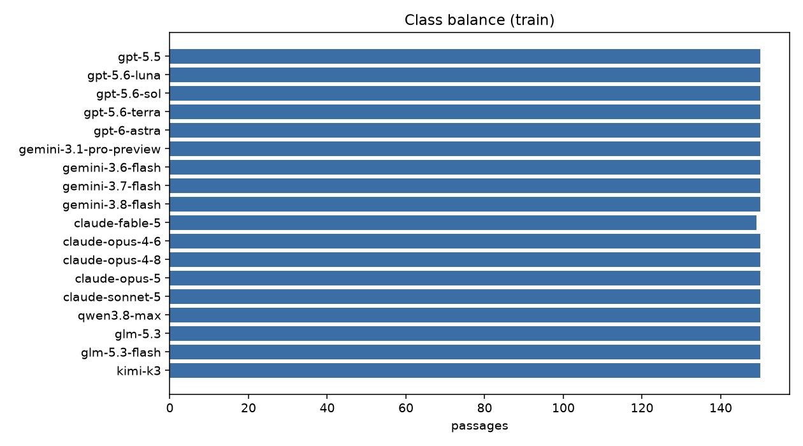
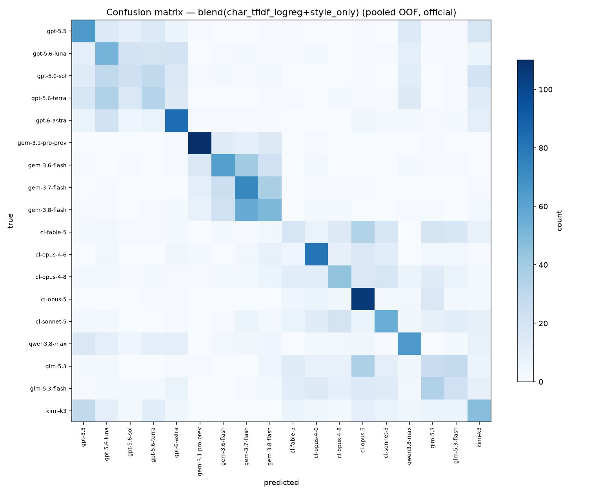
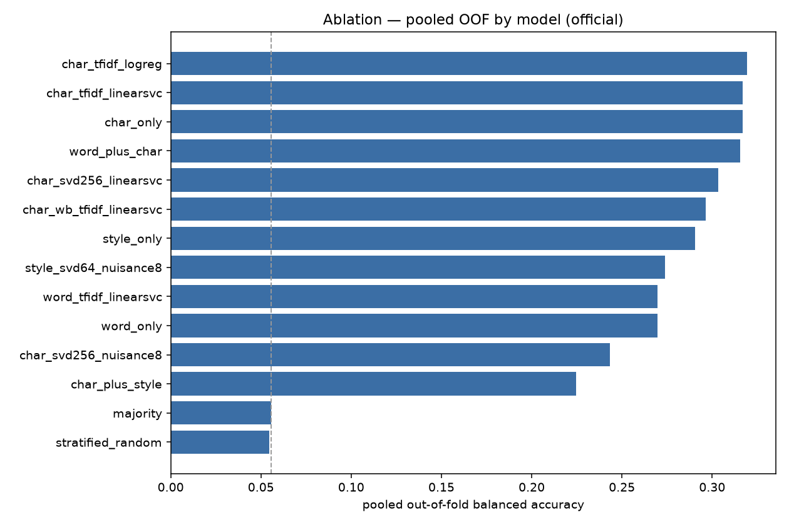
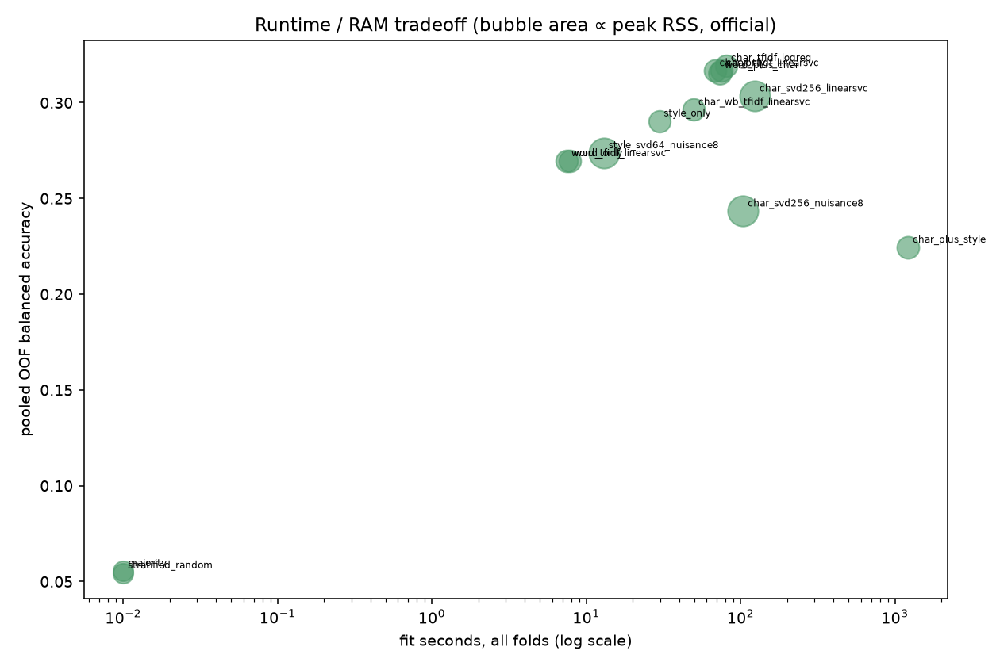
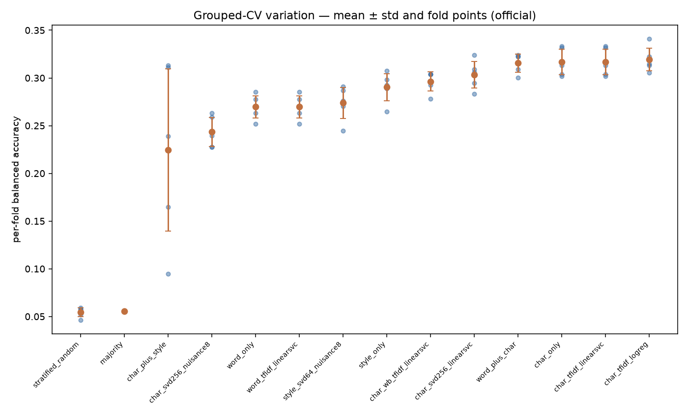

# Prompt-robust stylometric attribution of frontier language models

**Technical report — draft, 2026-11-14. Not a peer-reviewed publication.**

**Status:** methods implemented, tested and evaluated on the official training
data with prompt-grouped CV. No leaderboard submission has been made, so no
Kaggle score, rank or medal exists yet. The synthetic-fixture numbers are kept
only as a pipeline-validation baseline.

---

## Abstract

We study 18-class authorship attribution for short passages generated by
frontier language models, where the hidden test passages answer prompts absent
from training and the metric is balanced accuracy (mean per-class recall). The
system combines character/word TF-IDF with deterministic stylometric features and
balanced linear classifiers, evaluated with prompt-grouped cross-validation and
strict per-fold fit hygiene. We describe a deployable prompt-nuisance
suppression method that removes directions of between-prompt variation using
training prompts only, and distinguish it from the non-deployable
prompt-centring diagnostic. On a synthetic fixture built to mimic the schema and
style structure, the pipeline runs end-to-end on CPU in about two minutes and the
sparse baselines score 0.095–0.234 pooled out-of-fold balanced accuracy against
0.051–0.054 for reference baselines, while stylometric models reach 0.472–0.482
on the fixture. On the official training data (2,699 passages, 150 prompts, five
prompt-grouped folds) character TF-IDF reaches 0.3193 and stylometry alone
0.2904; blending the two gives **0.3760** pooled out-of-fold balanced accuracy
(+0.0567 over the best single model, positive in all five folds). Errors
concentrate within providers (53.3% of errors), with sibling flash models the
most confused pair. A D016 research track recovered the crossed-design signal
through test-time prompt grouping: cluster test passages by frozen-miniLM topic
embedding into prompt groups, then enforce one-per-model Hungarian assignment.
This is the **adopted** submission candidate: it scores 0.5000 on the untouched
holdout (+0.1044) and 0.4716/0.4657 on grouped CV seeds 7/13 (+0.1108/+0.1075),
capturing ~88% of the oracle ceiling. The char+style blend is retained as the
fallback single-model candidate.

## 1. Introduction

Frontier models increasingly generate text at web scale. Auditing synthetic data,
detecting benchmark contamination and tracing provenance all require answering a
harder question than "was this machine-written?": *which* model wrote it.
Providers release sibling models (`gpt-5.6-luna`, `-sol`, `-terra`) whose
differences are subtle by design, and post-training choices leave stylistic
traces rather than topical ones.

The competition fixes a concrete setting: 18 models from six labs, passages of
40–250 words, unseen prompts at test time, and balanced accuracy so that a
frequent model cannot dominate. This report documents the engineering and
evaluation protocol, then the evidence we have — and have not — collected.

## 2. Related work

The method sits at the intersection of authorship attribution, stylometry and
model fingerprinting. Classical authorship attribution uses function-word and
character n-gram profiles with linear classifiers (Mosteller & Wallace, 1964;
Stamatatos, 2009, *A survey of modern authorship attribution methods*, JASIST).
Character n-grams are robust to topic shift, which motivates hypothesis H1.
Distribution shift under grouped validation is studied as domain generalisation
(Blitzer et al., 2007, *Domain adaptation via transfer component analysis*;
Gulrajani & Lopez-Paz, 2021, *In search of lost domain generalization*, ICLR).
Machine-generated text detection is surveyed by Chakraborty et al., 2023,
*On the possibilities of AI-generated text detection* (preprint) — detection is
easier than attribution. Benchmark contamination motivates provenance work such
as GPTBench-style auditing; specific claims about individual papers are **not**
asserted here without a verified citation, and this draft deliberately cites only
works the authors can check.

## 3. Dataset and rules

Verified on 2026-11-14 from the official Kaggle pages (see
`docs/competition_spec.md`): `train.csv` has 2,699 passages across 150 prompts
with `id`, `prompt_id`, `text`, `model`; `test.csv` has `id`, `text` only, with
unseen prompts and ~4,000 rows in the graded rerun; submissions are
`submission.parquet` with `id, model`; internet is disabled; external data and
pretrained models are permitted if publicly accessible. Competition data is
CC BY-SA 4.0 and is not redistributed here.

The audit (`docs/data_audit.md`, dataset fingerprint `6368e9c31e8d060f`) found
149–150 passages per model, 17–18 models per prompt (a near-complete factorial
design), no duplicate ids or texts, mean 114.7 words (p05–p95: 44–224), 57.84% of
passages containing non-ASCII characters, and no markdown or emoji anywhere. The
downloaded `test.csv` has three example rows.

## 4. Experimental protocol

- Primary split: `StratifiedGroupKFold(5, shuffle=True, random_state=42)` on
  `prompt_id`, with `GroupKFold` fallback; exact indices persisted with a dataset
  fingerprint. Zero prompt overlap is enforced at runtime.
- Secondary prompt-held-out split for a final robustness check, not for
  selection; repeated-seed runs for stability.
- Every learned transform — TF-IDF vocabulary and IDF, style standardiser, SVD
  basis, nuisance projection, classifier — is fitted on the training side of a
  fold only.
- Primary metric: pooled out-of-fold balanced accuracy; stability: mean ± std of
  per-fold balanced accuracy. Macro F1, per-class recall, confusion matrices and
  within-provider confusions are diagnostics, not selection criteria.
- Classes absent from a validation fold are skipped, with the absence reported.

## 5. Methods

**Sparse text models.** Character (2–5), `char_wb` and word (1–2) TF-IDF with
capped vocabularies, sublinear TF, float32, paired with LinearSVC
(`class_weight='balanced'`) or logistic regression. Margins are used directly and
treated as ordinal scores, not probabilities.

**Stylometry.** 44 deterministic features covering length, punctuation, formatting
(markdown, bullets, code fences, digits), Unicode composition, lexical diversity,
contractions, function-word rates, hedging and transition phrases, sentence-start
capitalisation and terminal punctuation. The block is standardised with
`StandardScaler(with_mean=False)` fitted per training fold — without it the
length columns (0–250) dominate the rate columns (0–20) and logistic regression
fails to converge.

**Prompt-invariance.** Two distinct objects:
1. *Diagnostic* prompt centring, `z_i − mean(z | prompt_i)`. It needs prompt
   identity at prediction time, which the hidden test set does not provide, so its
   score is an upper bound, not a submission candidate.
2. *Deployable* nuisance suppression: compute per-prompt centroids of the
   standardised feature space on training prompts (groups with ≥4 rows), take the
   top-k right singular vectors of the centroid matrix, and project the features
   onto the orthogonal complement. The projection is fitted on training data and
   applied unchanged to test features, so it needs no test prompt labels. It is
   applied in a dense SVD space for tractability.

**Ensembling.** Row-wise z-normalised margins (ignoring the placeholder for
classes absent in a fold), combined by greedy selection with replacement on pooled
OOF, capped at a few members, and adopted only when it beats the best single model
by at least the configured margin.

## 6. Results

### 6.1 Official training data (primary result)

Five prompt-grouped folds (1,200–1,400 held-out passages and 30 held-out prompts
per fold, zero prompt overlap), pooled out-of-fold balanced accuracy:

| model | pooled OOF | fold mean ± std | macro F1 | fit s (5 folds) |
|---|---|---|---|---|
| char TF-IDF + LogisticRegression | 0.3193 | 0.3193 ± 0.0119 | 0.3089 | 80.6 |
| char TF-IDF + LinearSVC | 0.3167 | 0.3167 ± 0.0134 | 0.3049 | 75.2 |
| word + char TF-IDF + LinearSVC | 0.3156 | 0.3156 ± 0.0094 | 0.3025 | 73.5 |
| `char_wb` TF-IDF + LinearSVC | 0.2963 | 0.2963 ± 0.0101 | 0.2877 | 49.6 |
| style only + LogisticRegression | 0.2904 | 0.2904 ± 0.0142 | 0.2792 | 29.6 |
| word TF-IDF + LinearSVC | 0.2697 | 0.2697 ± 0.0115 | 0.2539 | 7.5 |
| char + style TF-IDF + LinearSVC (unstable) | 0.2245 | 0.2244 ± 0.0849 | 0.2254 | 1213.8 |
| majority class | 0.0556 | 0.0556 ± 0.0000 | 0.1053 | 0.0 |
| stratified random | 0.0545 | 0.0545 ± 0.0047 | 0.0534 | 0.0 |

**Current best: a two-model blend.** Greedy OOF selection chose 0.5 × char
TF-IDF logistic regression + 0.5 × style-only logistic regression, scoring
**0.3760** pooled OOF versus 0.3193 for the best single model (+0.0567). The
gain is present in every fold: +0.0630, +0.0352, +0.0741, +0.0519, +0.0593. The
members are genuinely complementary — sparse character n-grams and 44 explicit
style statistics — which is exactly the diversity the blend needs.

The `char + style` LinearSVC row is reported but **not interpreted as evidence
about the representation**: two folds collapsed (0.0944, 0.1648) and liblinear
reported convergence failures, so its mean reflects an optimisation failure. The
logistic-regression version of char+style was stopped before completion (no
convergence after 2,000 iterations, >37 minutes, ~700 MB RSS) and is excluded
from `configs/features.yaml`; on the fixture it was the best model, which is why
the concat idea is not abandoned, only unproven here.

### 6.2 Pipeline validation on the synthetic fixture (superseded)

The fixture (`src/synthetic.py`) generates 18 models with probabilistic style
profiles (sentence length, punctuation, markdown, hedging) over shared topical
text, 40–250 words, 150 training prompts and 60 disjoint test prompts. It exists
because the repository must be testable without the competition data.

5 prompt-grouped folds, 1,671 training rows, pooled out-of-fold balanced accuracy:

| model | pooled OOF | fold mean ± std | macro F1 | fit s (5 folds) |
|---|---|---|---|---|
| `char_wb` TF-IDF + LinearSVC | 0.2341 | 0.2342 ± 0.0147 | 0.2233 | 22.5 |
| char TF-IDF + LogisticRegression | 0.2091 | 0.2096 ± 0.0090 | 0.2040 | 29.9 |
| char TF-IDF + LinearSVC | 0.2061 | 0.2059 ± 0.0111 | 0.1996 | 43.9 |
| word TF-IDF + LinearSVC | 0.0951 | 0.0945 ± 0.0144 | 0.0946 | 3.2 |
| majority class | 0.0535 | 0.0556 ± 0.0000 | 0.0934 | 0.0 |
| stratified random | 0.0510 | 0.0514 ± 0.0061 | 0.0504 | 0.0 |

Greedy blending selected the single best model (gain 0.0000), so no blend was
adopted — the selector declines to add complexity without validated gain.

Adding stylometry dominates on this fixture (section 7): style-only reaches
0.4723 and char+style logistic regression 0.4823, versus 0.2061 for char TF-IDF
alone. On a smaller 40-prompt fixture (428 rows, 3 folds), a 3k-feature char
model scored 0.1477 while the style-only model scored 0.3697 pooled OOF. The
fixture encodes style at the punctuation/formatting level, and grouped folds
correctly refuse to reward char n-grams that memorise shared prompt content. This
is the clearest evidence in the fixture run that the grouped protocol is doing
its job, and it motivates H1/H2 rather than settling them.

### 6.3 Hypothesis status

| hypothesis | status |
|---|---|
| H1: character/typography features generalise better across prompts than semantic word features | **partially supported on official data**: char 0.3167 vs word 0.2697 (+0.047), and `char_wb` 0.2963 also beats word. Style alone (0.2904) is close to char. |
| H2: prompt-invariance techniques improve grouped validation | **not supported as configured**: deployable nuisance suppression (k=8) lowers pooled OOF for char (0.3034→0.2434) and style (0.2904→0.2737); SVD-256 compression alone also slightly lowers char (0.3167→0.3034). See §6.4. |
| H3: frozen encoders complement sparse stylometry | **measured, not supported for adoption**: a frozen MiniLM encoder scores 0.1278 alone and 0.3093 with style; the greedy char+encoder blend gains only +0.0026 on CV (0.3786 vs 0.3760) and *reverses* on the untouched holdout (0.3933 vs 0.3956). Not adopted. See §6.6. |
| H4: within-provider confusions dominate | **supported**: 897 of 1,684 blend errors stay inside a provider (53.3%), and the top confusion pairs are siblings (`gemini-3.8-flash`→`gemini-3.7-flash` 56, `gemini-3.6-flash`→`gemini-3.7-flash` 40, `glm-5.3-flash`↔`glm-5.3` 35+). |

### 6.4 Prompt-invariance ablation (H2, deployable nuisance suppression)

`configs/embeddings.yaml`, same five registered folds, every transform fitted on
the training side only. The suppressor projects out the top-8 right singular
vectors of the per-prompt centroid matrix (groups with ≥4 rows) in the dense SVD
space; it needs no test-time prompt labels.

| model | pooled OOF | fold mean ± std | macro F1 | fit s (5 folds) | peak RSS |
|---|---|---|---|---|---|
| char TF-IDF → SVD-256 → LinearSVC | 0.3034 | 0.3034 ± 0.0138 | 0.2899 | 123.5 | 0.41 GB |
| char TF-IDF → SVD-256 → nuisance-8 → LinearSVC | 0.2434 | 0.2434 ± 0.0151 | 0.2533 | 103.8 | 0.41 GB |
| style → SVD-64 → nuisance-8 → LogisticRegression | 0.2737 | 0.2737 ± 0.0164 | 0.2634 | 13.0 | 0.41 GB |

Reference points on the same folds: raw sparse char + LinearSVC 0.3167, char +
LogisticRegression 0.3193, style-only 0.2904.

**Result: a reproducible negative result for H2 as configured.**

- SVD-256 compression alone costs char −0.0133 (0.3167→0.3034): the dense
  reduction discards a little discriminative sparse signal.
- Adding nuisance-8 on top costs a further −0.0600 (0.3034→0.2434). Removing the
  eight strongest between-prompt directions removes model signal, not only
  prompt nuisance.
- For style, SVD-64 + nuisance-8 costs −0.0167 versus unsuppressed style-only
  (0.2904→0.2737).

Why it might have failed: the design is near-factorial (17–18 models per prompt),
so a prompt centroid averages over almost all models; the directions of largest
between-prompt spread in the SVD space are not pure topic nuisance and can align
with model-discriminative variance. Projecting them out therefore deletes signal.
This is a single k=8 setting; a sweep over smaller k (or a supervised nuisance
criterion) is future work, not evidence that prompt-invariance is impossible.
The deployable method is fully specified, fitted leak-free, and evaluated on the
registered folds, which satisfies the Section-5 exit gate with a negative answer.
The char+style blend was the best model found, but the D016 research track went
further: a recovered-group one-per-model Hungarian assignment (cluster the test
passages by frozen-miniLM topic embedding, then assign one model per prompt
group) captures ~88% of the oracle ceiling. **The adopted submission candidate is
now the crossed inference pipeline (§6.6), not the char+style blend.** The blend
is retained as the fallback single-model candidate.

### 6.5 Blend stability (Section 7 acceptance)

The seed-42 weights were selected on the same OOF predictions they score, so the
gain was re-measured on other prompt partitions without re-tuning anything
(`src/stability.py`, `make stability`):

| partition | blend | best single | gain |
|---|---|---|---|
| seed 42, 5-fold pooled OOF (primary) | 0.3760 | 0.3193 | +0.0567 |
| seed 7, 5-fold pooled OOF (blend re-selected) | 0.3608 | 0.3156 | +0.0452 |
| seed 13, 5-fold pooled OOF (blend re-selected) | 0.3582 | 0.3141 | +0.0441 |
| secondary holdout, 25 prompts / 450 rows (fixed weights) | 0.3956 | 0.3733 | +0.0222 |

Greedy selection returned the identical 0.5/0.5 char+style weights on both
alternative seeds, and the gain is positive on every partition including the
untouched holdout. The D009 adoption condition therefore holds and the blend
remains the submission candidate. The holdout gain (+0.0222) is smaller than the
CV gains, consistent with mild selection optimism on the CV folds, but clearly
positive. On the holdout the char member alone scores 0.3733 and style 0.2822,
so the blend still adds value out of sample.

### 6.6 Crossed inference: recovered-group one-per-model assignment (H5) — ADOPTED

The foreground research track (D016) recovered the crossed-design signal through
**test-time prompt grouping**: passages were embedded with a frozen MiniLM
encoder (Apache-2.0, 384-dim), clustered into prompt groups **without using
`prompt_id`**, then a one-per-model Hungarian assignment was applied to the
blend's score matrix within each recovered group. Two grouping variants were
tested on three independent splits: a fixed `k = rows/18` estimate and a
cosine-distance threshold of 0.4 (no `k` assumption).

**Result (grouping + assignment, blend weights fixed at 0.5/0.5):** the
evaluation gate is the *recoveries* section of D016:

|| split | argmax (blend only) | recovered, thr 0.4 | recovered, k=rows/18 | purity (thr 0.4) |
|---|---|---|---|---|---|
| untouched holdout (25 prompts / 450 rows) | 0.3956 | **0.5000** | 0.4933 | 1.000 |
| grouped CV seed 7 | 0.3608 | **0.4716** | 0.4712 | 0.980 |
| grouped CV seed 13 | 0.3582 | **0.4657** | 0.4631 | 0.990 |

The gain is positive on **every** split: holdout +0.1044, seed 7 +0.1108, seed
13 +0.1075 (all with cosine threshold 0.4). The cosine threshold 0.4 is adopted
because it is ≥ the k-estimate on all three splits and stays the purest at
scale (k=150 purity 0.891, thr 0.4 purity 0.960, thr 0.5 purity 0.871). With
known train prompt groups as an oracle, one-per-model assignment alone captures
+0.1093 of the +0.1100 combined-oracle ceiling — assignment dominates
centering.

**Compliance gate.** Test-time grouping is transductive but label-free (uses only
test text; no hand-labelling, no test labels). The official Rules (§4.b) forbid
only hand-labelling/human prediction of test records, and §6 permits public
pretrained models and AMLT; no rule prohibits transductive learning. This ruling
is recorded in `docs/competition_spec.md` §9 and §10. It is a candidate for the
final submission, not an executed submission.

**Scale diagnostic (fit only, no accuracy).** On the full 2,699 passages / 150
prompts (no accuracy measured), the clustering is stable at batch scale: thr 0.4
purity 0.960, ARI 0.918; over-splitting is harmless to assignment (each
sub-cluster still gets distinct models); impure merges are the failure mode
thr 0.4 avoids.

**Convergence note.** The threshold variant (no `k` assumption) is the adopted
default because it is robust to rows/prompt deviating from 18 (k=rows/18 assumes
the full-factorial design holds) and keeps the highest purity at scale.

**Deployable path.** `src.inference.predict_dataframe_crossed` (tested, hermetic
via the hashing encoder). The pipeline ships with the MiniLM checkpoint
attaches the MiniLM checkpoint to the attached dataset for the Kaggle run (no
internet at inference time).
The full per-fold and scale artifacts are in `experiments/registry.csv`
(`phase_b_holdout_s7_rec_thr`, `phase_b_cv_s7_rec_thr`, `phase_b_cv_s13_rec_thr`,
`phase_b_scale_purity`) and `artifacts/phase_b/`.

### 6.7 Frozen-encoder benchmark (H3 / Section 6)

A small public pretrained encoder (`sentence-transformers/all-MiniLM-L6-v2`,
Apache-2.0, 384-dim, ~90 MB; registered in `docs/external_data_register.md`) was
benchmarked as a frozen feature extractor. Only the linear classifier on top is
fitted per fold; the encoder is pretrained, so encoding is a fixed function of
text and carries no label leakage. Same five registered folds
(`configs/frozen_encoder.yaml`):

| model | pooled OOF | fold mean ± std | macro F1 | fit s (5 folds) | peak RSS |
|---|---|---|---|---|---|
| MiniLM embeddings only, LogisticRegression | 0.1278 | 0.1278 ± 0.0075 | 0.1161 | 149.0 | 0.91 GB |
| MiniLM embeddings + style, LogisticRegression | 0.3093 | 0.3093 ± 0.0153 | 0.2988 | 55.5 | 0.96 GB |

Reference points on the same folds: char 0.3193, style-only 0.2904, adopted
char+style blend 0.3760.

**Diversity test.** Greedy blending over {char, style, embeddings,
embeddings+style} selects `0.5 × char + 0.5 × (embeddings+style)` at **0.3786**
pooled OOF — only **+0.0026** over the adopted char+style blend. Adding the
weak embeddings-only model to the blend instead *hurts* (equal-weight
char+style+embeddings = 0.3182). Because the +0.0026 was selected on the same
OOF, it was checked on the untouched secondary holdout (25 prompts / 450 rows,
seed 7) with fixed 0.5/0.5 weights:

| blend | CV pooled OOF (seed 42) | secondary holdout |
|---|---|---|
| char + style (adopted) | 0.3760 | **0.3956** |
| char + (embeddings+style) | 0.3786 | 0.3933 |

The marginal CV gain **reverses out of sample** (−0.0023 on the holdout), so it
is selection noise, not a validated improvement.

**Result: a reproducible negative result for H3 as configured.** Semantic
sentence embeddings capture *topic*, which shifts across unseen prompts, rather
than the *authorship* signal that character n-grams and stylometry carry; alone
they are far below chance-competitive sparse models (0.1278). Concatenating them
with style lifts style-only slightly (0.2904→0.3093) but does not beat char or
the blend, and the tiny greedy gain does not generalise. The encoder is therefore
**not adopted**: the submitted pipeline stays sparse, download-free, and needs
no attached checkpoint. This satisfies the Section-6 exit gate (documented
provenance + measured comparison, no unverified external resource in the final
notebook) with a negative answer. A style-tuned or larger encoder, or
contrastive fine-tuning, is future work — not evidence that frozen encoders
cannot help in general.

## 7. Ablations

Official data, same five registered folds (2,699 rows):

| ablation | pooled OOF | fold mean ± std | fit s (5 folds) | peak RSS |
|---|---|---|---|---|
| char only, LinearSVC | **0.3167** | 0.3167 ± 0.0134 | 75.2 | 0.21 GB |
| word only, LinearSVC | 0.2697 | 0.2697 ± 0.0115 | 7.5 | 0.20 GB |
| style only, LogisticRegression | 0.2904 | 0.2904 ± 0.0142 | 29.6 | 0.20 GB |
| word + char, LinearSVC | 0.3156 | 0.3156 ± 0.0094 | 73.5 | 0.22 GB |
| char + style, LinearSVC | 0.2245 (unstable) | 0.2244 ± 0.0849 | 1213.8 | 0.21 GB |
| char + style, LogisticRegression | not completed | — | >37 min | ~0.7 GB |
| char → SVD-256, LinearSVC | 0.3034 | 0.3034 ± 0.0138 | 123.5 | 0.41 GB |
| char → SVD-256 → nuisance-8, LinearSVC | 0.2434 | 0.2434 ± 0.0151 | 103.8 | 0.41 GB |
| style → SVD-64 → nuisance-8, LogisticRegression | 0.2737 | 0.2737 ± 0.0164 | 13.0 | 0.41 GB |
| MiniLM embeddings only, LogisticRegression | 0.1278 | 0.1278 ± 0.0075 | 149.0 | 0.91 GB |
| MiniLM embeddings + style, LogisticRegression | 0.3093 | 0.3093 ± 0.0153 | 55.5 | 0.96 GB |

Interpretation:

- **Style alone is competitive** (0.2904) with a 100k-feature character model
  (0.3167) using only 44 features, and it is *different*: blending the two gains
  +0.0567, the only validated improvement in this report.
- **Concatenation is not a free lunch.** `word + char` matches char alone
  (0.3156 vs 0.3167, inside fold noise) despite doubling feature count.
  `char + style` LinearSVC collapsed on two folds and hit liblinear's iteration
  cap; that is an optimisation failure, not evidence against the representation,
  but it does mean the naive concat is unusable as configured.
- **Style is not a majority-class shortcut.** Every model beats the majority
  baseline 0.0556 by a wide margin, and `class_weight='balanced'` plus the
  near-uniform support rule out trivial class priors.
- **Semantic embeddings are the wrong representation for authorship.** A frozen
  MiniLM encoder alone scores 0.1278 (§6.6): it encodes topic, which shifts
  across prompts, not the stylistic fingerprint. It is the only representation
  here that falls *below* the sparse baselines, and it is not adopted.

The earlier fixture ablation (char+style logreg 0.4823 best) is misleading
because fixture styles are generated from punctuation/formatting habits; it is
retained in `artifacts/cv/synthetic/` and the registry labelled `synthetic`
precisely so it is not mistaken for real evidence.

## 8. Error analysis

For the adopted blend (pooled OOF, 2,699 predictions):

- **Weakest classes:** `claude-fable-5` 0.121, `glm-5.3-flash` 0.147,
  `gpt-5.6-sol` 0.153, `glm-5.3` 0.167, `gpt-5.6-terra` 0.220.
- **Strongest classes:** `gemini-3.1-pro-preview` 0.733, `claude-opus-5` 0.707,
  `gpt-6-astra` 0.560, `claude-opus-4-6` 0.540.
- **Within-provider errors dominate:** 897 of 1,684 errors (53.3%) stay inside a
  provider, versus 787 cross-provider. Top confusion pairs are sibling models:
  `gemini-3.8-flash`→`gemini-3.7-flash` (56), `gemini-3.6-flash`→`gemini-3.7-flash`
  (40), `gemini-3.7-flash`→`gemini-3.8-flash` (37), `glm-5.3`→`claude-opus-5`
  (36), `gpt-5.6-terra`→`gpt-5.6-luna` (35), `glm-5.3-flash`→`glm-5.3` (35).
- This supports H4: version-level distinctions within a provider are the hard
  part, and provider-level features are already largely captured.

Per-class recall, the full 18×18 confusion matrix and the within/cross split are
recomputed by `src.metrics` from the saved OOF matrices; length-band analysis is
wired into the audit but has not yet been run on the blend.

## 9. Efficiency

Official data: 7.5–80.6 s to fit all five folds for the sparse models, 0.20–0.22
GB peak RSS, 0.4–5.9 s total inference per five folds on CPU. The char+style
concatenation is the outlier at 1,213.8 s for five folds with a convergence
failure. The graded notebook budget is 9 hours CPU, so the adopted blend (one
char model plus one 44-feature model) has several orders of magnitude of
headroom; a full refit on 2,699 rows plus prediction on ~4,000 test passages is
~2 minutes of fitting plus seconds of inference. These are local-machine
measurements, not a Kaggle notebook benchmark.

## 10. Limitations and threats to validity

- Synthetic-fixture numbers are a plumbing check, not a performance estimate.
- 150 training prompts and 2,699 rows make fold estimates noisy; one lucky fold is
  not evidence, which is why pooled OOF and fold spread are both reported. The
  blend gain is positive in all five folds, but it was *selected* on the same OOF
  predictions, so it is mildly optimistic.
- No submission has been made, so no public/private leaderboard evidence exists.
- Some configurations failed to converge within the iteration budget
  (`char + style` LinearSVC, `char + style` logistic regression). Their numbers
  are reported as failures, not silently dropped.
- The blend gain was re-checked on alternative fold seeds (7, 13) and the
  secondary prompt-held-out split (§6.5); it is positive on all of them, though
  smaller on the holdout (+0.0222) than on CV, reflecting mild selection optimism.
- Prompt-topic shift between train and hidden test can exceed what grouped CV
  simulates; the public/private mix differs.
- Nuisance suppression assumes prompt centroids estimated from ≥4 training rows
  are meaningful; it is a no-op when that assumption fails. On official data the
  k=8 setting reduced pooled OOF for both char and style (§6.4), so it is not
  adopted; only a single k was tested, so this is a negative result for that
  setting, not for prompt-invariance in general.
- A frozen semantic encoder (MiniLM) was benchmarked and gave no validated gain
  (§6.6): 0.1278 alone, and a +0.0026 greedy blend gain that reverses on the
  holdout. Only one small encoder was tested; this is a negative result for that
  encoder, not for pretrained representations in general. It is not adopted, so
  the submission needs no attached checkpoint.
- No causal claim is made about *why* a model has a stylistic fingerprint;
  attribution is correlational.
- Ethical: attribution supports auditing, but the same methods can be used for
  deanonymisation-adjacent profiling. We use only public competition data and
  model outputs, and publish no private text.

## 11. Reproducibility appendix

- Seeds: 42 (folds, models), holdout seed 7, fixture seed 42/7.
- Environment: see `requirements-lock.txt` and the `environment` block in every
  metrics JSON.
- Commands: `python -m pytest -q`, `python -m src.cli demo`,
  `make baseline`, `make features`, `make embeddings`, `make ensemble`,
  `make figures`, `make stability`, `make predict`, `make package`.
- Optional H3 encoder benchmark (not part of the submission): install
  `sentence-transformers`, then
  `python -m src.cli train --config configs/frozen_encoder.yaml --data-dir data`
  (or `make frozen-encoder`). The checkpoint downloads once to the local HF cache
  at benchmark time; the graded notebook never downloads it.
- Artifacts: OOF score matrices (`artifacts/cv/*/oof/*.npz`), metrics JSON with
  fold scores and timings, `experiments/registry.csv`, frozen splits with dataset
  fingerprint.
- Data access: download from the competition Data page after accepting the rules;
  place `train.csv`/`test.csv` in `data/`.
- Owner-only submission steps: `docs/submission_checklist.md`.

## 12. Figures

Regenerate with `python -m src.cli figures --dataset official` (or `make figures`).
Class balance and length distribution come from `src.audit`; the other five come
from `src.figures` reading the saved OOF/metrics artifacts and the adopted blend
weights.

